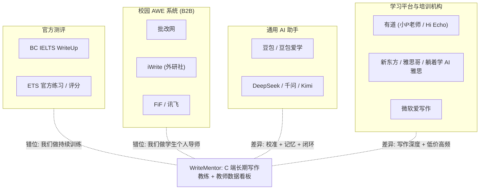
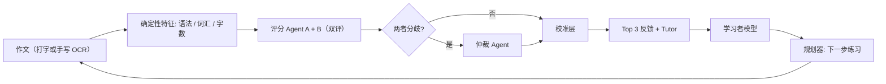
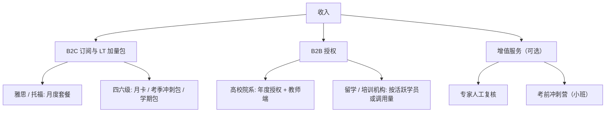
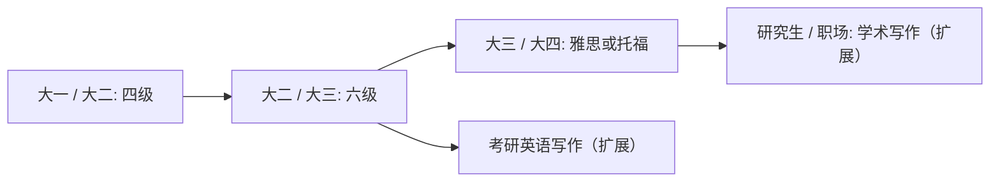
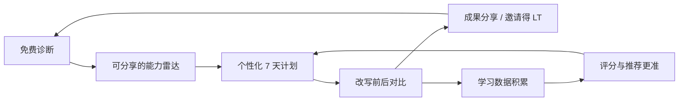
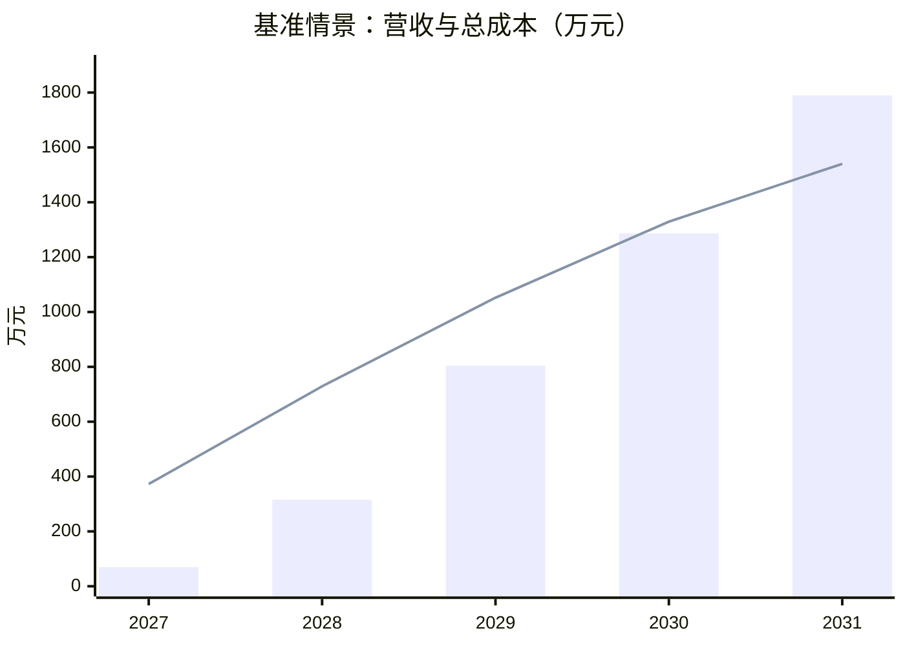

# WriteMentor（暂定名）商业计划书

## AI 个性化英语写作教练 —— 从雅思出发，覆盖四六级与托福

| 项目 | 内容 |
|---|---|
| 文件性质 | 内部规划与对齐用商业计划书 |
| 版本 | v1.0 |
| 日期 | 2026 年 10 月 |
| 配套文件 | 《产品设计与技术原型方案》《营收模型（Excel）》 |

---

## 目录

1. 执行摘要
2. 项目概述
3. 市场分析（深化）
4. 竞争分析
5. 产品与技术方案
6. 商业模式与定价
7. 市场进入与增长策略
8. 运营计划与里程碑
9. 团队与组织
10. 财务预测
11. 风险分析与应对
12. 合规与知识产权
13. 附录

---

## 一、执行摘要

### 1.1 我们要解决的问题

中国每年有数千万人次参加有写作要求的英语考试：四六级全年估算 1,800–2,500 万人次，雅思约 50–85 万人/人次，托福约 25–40 万人次。**写作普遍是失分最多、最难自学提升的部分**。2024–2025 年中国大陆学术类雅思考生写作平均只有 5.7 分，低于阅读的 6.2 分；53% 的考生卡在“逻辑不清、词汇不足、语法错误多”；国内多项研究显示，55%–75% 的大学生有中高程度的英语写作焦虑。

学生现在能用的解决方案各有缺陷：

- **人工批改**：贵、慢，没法高频练习。
- **通用 AI**（豆包、DeepSeek 等）：免费，但每次对话都“不记得你”，分数不稳定，也不监督你改写。
- **校园 AWE 系统**（批改网、iWrite）：本质是教师布置作业的工具，反馈偏重拼写语法等浅层问题，课程一结束学习记录就断了。
- **官方测评**（BC WriteUp）：评分可信，但定位是一次性测评，不是持续训练。

### 1.2 我们的方案

**WriteMentor 是一位会记住你写过的每一篇作文的 AI 写作教练。** 它的核心能力有三项：

1. **可信评分**：两个评分器独立打分，分歧时再仲裁，最后用专家标注的校准集修正，输出分数和置信区间。
2. **长期学习者模型**：跨作文追踪错误模式和弱项掌握度。
3. **改写闭环**：每篇只讲 3 个最影响提分的问题，用分级提示引导学生自己改写、再评分、写反思，并自动安排下一步练习。

雅思、四六级、托福共用同一套引擎，考试差异通过“考试包”配置实现。

### 1.3 为什么是现在

- **考试机考化**：雅思自 2026 年 9 月起全面改为机考；托福 2026 年 1 月改版，写作变为三种新题型。考生需要重新适应。
- **技术成本骤降**：一次深度批改的模型推理成本只有几分钱，经过校准的 LLM 评分已接近人类评分员之间的一致性（研究报告 QWK 0.84，人与人之间为 0.87）。
- **用户习惯形成**：99.2% 的受访大学生使用 AI；有道的 AI 订阅 2025 年销售额接近 4 亿元，同比增长超过 50%，证明中国用户愿意为 AI 学习付费。
- **政策支持**：国务院“人工智能+”行动意见、五部门《“人工智能+教育”行动计划》都明确支持“智能学伴”和个性化学习。

### 1.4 市场机会

| 考试线 | 年度人群 | 狭义可服务市场（SAM，年） | 角色 |
|---|---|---:|---|
| 雅思 | 50–85 万 | 约 0.7 亿元 | 首发，打磨产品与评分，高客单价 |
| 四六级（C 端 + 高校 B2B） | 全年 1,800–2,500 万人次 | 约 2.1 亿元 | 规模与获客池；B2B 稳定收入 |
| 托福 | 25–40 万人次 | 约 0.3 亿元 | 低增量成本扩展，高客单价 |
| **合计** | | **约 3.1 亿元** | 是只做雅思的 4 倍以上 |

### 1.5 财务概览（基准情景）

| 万元 | 2027 | 2028 | 2029 | 2030 | 2031 |
|---|---:|---:|---:|---:|---:|
| 总营收 | 70 | 316 | 804 | 1,286 | 1,790 |
| 经营利润 | -303 | -413 | -248 | -43 | +250 |
| 年度付费用户（万人） | 0.4 | 1.8 | 3.8 | 5.6 | 6.8 |

- 毛利率 82–86%。2030 年接近盈亏平衡，2031 年实现盈利。
- 建议分两轮融资约 **1,200 万元**：天使轮 600 万元，Pre-A 轮 600–700 万元。
- **最敏感的变量是付费转化率和付费时长，而不是 AI 成本。**

### 1.6 关键结论

> **GO，以“雅思单点验证 → 四六级放量 → 托福与 B2B 扩展”的节奏推进；每个阶段设硬性 Gate，未达标即转向。**

---

## 二、项目概述

### 2.1 使命与愿景

- **使命**：让每一个中国英语学习者都拥有一位记得他、懂他、能持续督促他进步的写作教练。
- **愿景**：成为中国学生“英语输出能力”的长期学习伙伴，覆盖从大学四六级、出国考试到学术写作的完整周期。

### 2.2 产品一句话

> **“一个记得你过去 30 篇作文、知道你为什么一直卡在 6 分，并每天决定你下一步应该练什么的 AI 写作教练。”**

### 2.3 发展阶段

| 阶段 | 时间 | 内容 |
|---|---|---|
| 当前 | 2026-10 | 完成赛道研究、商业计划、产品与技术方案 |
| 下一步 | 2026-11 至 2027-05 | 雅思 MVP、Gold Set、Alpha/Beta 测试 |
| 中期 | 2027-09 至 2028-06 | 四六级上线，托福上线，高校与机构 B2B |
| 远期 | 2029 起 | 口语、考研英语写作、学术英语写作 |

### 2.4 核心差异化

| 维度 | 一般 AI 批改 | WriteMentor |
|---|---|---|
| 评分 | 单次 LLM 输出 | 双评 + 仲裁 + 校准 + 置信区间 |
| 记忆 | 无（每次从零开始） | 跨作文、跨考试的长期学习者模型 |
| 反馈 | 面面俱到、信息过载 | 每篇只讲 Top 3 问题，且定位到句子 |
| 教学 | 直接给范文 | 提示 → 追问 → 示范 → 范文（逐级解锁） |
| 行为 | 看完就走 | 强制改写、再评分、写反思 |
| 规划 | 无 | 每天自动生成练习计划 |

---

## 三、市场分析（深化）

本章分五步论证“需求是否真实存在”：①宏观环境；②三大考试市场的人群与痛点；③需求证据链（痛点、现有方案缺口、付费意愿、效果可行性）；④市场规模测算；⑤仍需一手验证的假设及验证计划。

> [!NOTE]
> 数据可信度分三级：**高** = 官方或原始统计；**中** = 可信媒体、机构报告或厂商自述；**低** = 二手估算。官方未公布的数据一律注明“未明确”或“代理值”。完整来源见附录 A。

### 3.1 宏观环境（PEST）

| 维度 | 关键事实 | 对项目的含义 |
|---|---|---|
| **政策** | 国务院《关于深入实施“人工智能+”行动的意见》（国发〔2025〕11 号）提出“智能学伴、智能教师等人机协同教育教学新模式”和“大规模因材施教”；教育部等九部门《关于加快推进教育数字化的意见》（2025-04）；五部门《“人工智能+教育”行动计划》（2026-04）提出研发智能学伴、推动个性化学习，同时要求严格审核教育大模型、防范隐私泄露与学术造假 | 方向受鼓励，但必须合规。面向大学生和成人的考试辅导不在“双减”范围内 |
| **经济** | 七成以上大学生月生活费在 1,000–2,000 元；大学生学习类支出中，语言培训占 41%；传统雅思/四六级课程价格从数百元到上万元不等 | 大学生价格敏感，但对“考试刚需”愿意付费；AI 工具的合理价格带是每月 ¥20–80 |
| **社会** | 生成式 AI 用户 6.02 亿，普及率 42.8%（CNNIC，2025-12）；99.2% 的受访大学生使用 AI，65.9% 遇到问题先问 AI（中国青年报，样本 3,129）；四六级仍是央国企校招和考研复试的重要门槛 | 用户习惯已经形成，产品无需教育市场“什么是 AI” |
| **技术** | 经过校准的 GPT-4 类模型作文评分 QWK 达 0.84，接近人类评分员之间的 0.87；境内模型 API 每百万 token 只要几元；AWE 元分析显示效应量 g ≈ 0.55–0.59 | 技术可行，成本可控；**关键在于校准和学习闭环** |

### 3.2 三大考试市场画像

#### 3.2.1 雅思（首发市场）

| 指标 | 数据 | 可信度 |
|---|---|---|
| 年度考生 | 50–85 万人/人次（媒体估计；官方未公布）；本计划取 65 万 | 低 |
| 写作水平 | 学术类写作平均 5.7，在四项中仅高于口语（5.5），低于阅读（6.2）和听力（5.9）；53% 的考生卡在“逻辑不清、词汇不足、语法错误多” | 高 |
| 考试变化 | UKVI 雅思自 2026-07-01、普通雅思自 2026-09-01 起停考纸笔，全面机考；单科重考已在中国大陆开放（BC 主办的机考，60 天内可重考一个科目） | 中高 |
| 考试费 | ¥1,990（2026 年），单科重考约 ¥1,400 | 高 |
| 用途 | 留学多国联申；55% 的受访职场人士遇到过把雅思作为岗位或晋升门槛的情况 | 高 |
| 季节性 | 暑假（7–8 月）为最大高峰，9–12 月申请季冲刺，3–4 月为小高峰 | 中（机构经验） |

**需求判断**：写作是明确短板，**单科重考**让“专门冲写作分”成为一个清晰的付费场景；机考化带来了“电脑上限时写作”的新练习需求。客单价高、付费能力强，适合作为打磨评分质量的首发市场。

#### 3.2.2 大学英语四六级（规模市场）

| 指标 | 数据 | 可信度 |
|---|---|---|
| 年度报考 | 官方不公布全国总数。江苏单次 94.4–101.3 万人（2024-12 为 101.3 万，2025-06 为 94.4 万）；按江苏在校生占比推算，全国全年约 **1,800–2,500 万人次**（媒体常用口径“每年超过千万人次”）。本计划保守取 **1,000 万人/年** 作为代理值 | 省级高 / 全国估算中低 |
| 潜在人群 | 2025 年普通本科在校生 2,135.77 万，本专科在校生合计 3,953.96 万；每年本科招生约 500 万，构成四级首考人群 | 高 |
| 写作规格 | 30 分钟；CET-4 120–180 词，CET-6 150–200 词；占总分 15%（106.5 分）；整体印象评分，分 14/11/8/5/2 五档 | 高 |
| 通过与重考 | 官方不设及格线，425 分是社会通行门槛；四级通过率约 40%–50%（估算）；多所高校因考位紧张出台“已达 425 不得再报”等限制 | 中 |
| 刚需 | 央国企、银行校招普遍以四级 425 作为简历门槛；涉外和金融监管类公务员岗位要求六级；考研复试和保研参考四六级成绩 | 中 |
| 作答形式 | **纸笔手写**（产品必须支持拍照 OCR） | 高 |
| 季节性 | 笔试每年 6 月和 12 月（2026 年为 6 月 13 日、12 月 12 日），备考高峰在 3–6 月和 9–12 月 | 高 |
| 题目趋势 | 近年作文题偏向思辨与时政（如“文化自信”“青年责任”），套模板的风险上升 | 中 |

**需求判断**：人群规模是雅思的 20 倍以上，写作焦虑普遍，并且**套模板越来越难拿高分**，这为“个性化反馈 + 改写训练”创造了需求。但大学生价格敏感，C 端客单价低，因此四六级的定位是“**获客池 + 高校 B2B**”。

#### 3.2.3 托福（扩展市场）

| 指标 | 数据 | 可信度 |
|---|---|---|
| 年度考生 | ETS 不公布分国数据；媒体与机构估计中国大陆每年约 **30–40 万人次**。本计划保守取 25 万 | 低 |
| 2026 改版 | 自 2026-01-21 起，写作部分改为 Build a Sentence（句子重组）、Write an Email（写邮件）、Academic Discussion（学术讨论）三种题型，共约 23 分钟；成绩改为 1–6 分制（0.5 分一档），过渡期同时提供 0–120 对照 | 中高 |
| 考试费 | 约 ¥2,100 | 中 |
| 写作平均分 | 中国考生写作平均分：**未明确**（ETS 分国报告未在本次检索中核实） | — |
| 趋势 | 留学目的地向英国、中国香港、新加坡、澳大利亚、欧洲多元化，雅思份额上升；托福仍是北美名校申请的主流考试；低龄化明显（小托福） | 中 |

**需求判断**：改版后的新题型（尤其是邮件写作和学术讨论）目前**缺少成熟的练习资料和 AI 评测**，这是一个短期窗口。由于共用引擎，托福包的增量成本主要是题库和校准集，所以即使托福市场体量有限，也值得作为第三条线。

#### 3.2.4 相邻市场（远期选项）

| 市场 | 规模 | 说明 |
|---|---|---|
| 考研英语写作 | 2026 年报名 343 万（2023 年峰值 474 万，连续三年下降） | 写作占英语一 30 分、英语二 25 分；可复用四六级引擎 |
| 英语专业四级 / 八级 | 每年约 40 万（估算） | 体量较小 |
| 学术英语写作 | 研究生、科研人员 | 客单价高，需要另做产品形态 |

### 3.3 需求证据链

“切实的市场需求”需要同时满足四个条件：**痛点真实存在、现有方案不能很好解决、用户愿意付费、我们的方案在技术上有效**。下表逐条列出证据：

| 论证环节 | 证据 | 强度 |
|---|---|---|
| **① 痛点真实** | 雅思写作 5.7 分是中国考生的第二短板；53% 的考生卡在逻辑、词汇、语法 | 强（官方） |
| | 55%–75% 的大学生有中高程度的英语写作焦虑，且焦虑与写作成绩显著负相关 | 中（多项学术研究） |
| | 四六级题目趋向思辨，模板化写作的效果下降；高校考位“秒光”，反映出大量重考和刷分需求 | 中 |
| | 雅思单科重考开放，托福 2026 改版，都带来写作专项冲刺的需求 | 强（官方） |
| **② 现有方案有缺口** | 通用 AI 助手（豆包月活 4.19 亿）能批改作文，但需要用户自己写提示词，没有固定的评分标准，也没有学习档案 | 强 |
| | 批改网（累计批改近 10 亿篇）和 iWrite（541 万师生）是 B 端作业工具；研究指出其反馈偏重浅层语言问题，学生倾向于“改词刷分”，课程结束后学习记录中断 | 中 |
| | BC WriteUp 定位为单次测评（6 次 ¥149.9），未见公开的长期学习者模型或训练规划功能 | 中 |
| | 调研未发现面向 C 端、同时具备“跨篇章错误画像 + 对标考试档次的提分路径 + 强制改写再评闭环”的产品 | 中（基于公开信息） |
| **③ 付费意愿** | 有道 AI 订阅 2025 年销售额接近 4 亿元（同比增长 50% 以上），第四季度超过 1 亿元（同比增长 80% 以上） | 强 |
| | BC WriteUp 以约 ¥25/次的价格售卖写作测评；Hi Echo 口语私教月费 ¥68–168 | 强（已有价格锚点） |
| | 大学生学习类支出中，语言培训占比最高（41%）；约三成大学生在考试刚需场景下愿意为 AI 付费，心理价位为每月 ¥30–50 | 中低（媒体调查） |
| **④ 方案有效** | AWE 元分析：Fleckenstein et al. 2023（20 项研究，N=2,828）g = 0.55；Ngo et al. 2022 g = 0.59；在本科、EFL、中等水平学习者中效果最好，**使用时间越长、配合多稿修改效果越强** | 强（学术） |
| | 经过校准的 GPT-4 作文评分 QWK 0.84，人与人之间为 0.87（Yancey et al. 2023）；不加校准时雅思评分 QWK 只有约 0.45–0.68 | 强（学术） |

**结论**：痛点、缺口、付费意愿、技术可行性四个环节都有公开证据支持。其中**“长期使用 + 多稿修改效果更好”的学术证据，与我们“学习者模型 + 改写闭环”的产品设计直接对应**，这是本项目区别于“又一个 AI 批改器”的核心依据。

### 3.4 市场规模测算

#### 3.4.1 自下而上的狭义可服务市场（SAM）

| 考试线 | 计算公式 | 年度 SAM |
|---|---|---:|
| 雅思 C 端 | 65 万 × 45%（愿为 AI 写作付费的比例）× ¥240/年 | 约 ¥7,000 万 |
| 四六级 C 端 | 1,000 万 × 10% × ¥60/年 | 约 ¥6,000 万 |
| 四六级高校 B2B | 全国普通高校约 3,000 所 × ¥5 万/年 | 约 ¥1.5 亿 |
| 托福 C 端 | 25 万 × 45% × ¥240/年 | 约 ¥2,700 万 |
| **合计** | | **约 ¥3.1 亿** |
| （远期）考研英语写作 | 343 万 × 10% × ¥60/年 | 约 ¥2,000 万 |

> [!IMPORTANT]
> 渗透率与客单价是本计划的**建模假设**，不是行业统计。四六级的人群取值（1,000 万）低于全年报考人次的估算（1,800–2,500 万），已做保守处理。

#### 3.4.2 可获得市场（SOM）

按基准财务模型，2031 年营收约 ¥1,790 万，约占狭义 SAM 的 **5.8%**。其中雅思 B2C 约占雅思 SAM 的 7.6%，四六级 C 端约占 3.8%，高校 B2B 约占 2.4%，托福 B2C 约占 6.6%。对一家专注型创业公司来说，这是可以实现的份额。

#### 3.4.3 多考试线带来的结构性改善

| 维度 | 只做雅思 | 雅思 + 四六级 + 托福 |
|---|---|---|
| SAM | 约 0.7 亿 | 约 3.1 亿（4.4 倍） |
| 季节性 | 暑假单峰 | 雅思暑假高峰、四六级 6 月/12 月双峰、托福申请季，三者互补 |
| 用户生命周期 | 2–3 个月 | 大一四级 → 六级 → 出国考试，可达 2–3 年 |
| 获客 | 依赖内容与投放 | 校园渠道 + 高校 B2B 带来低成本流量 |
| 收入稳定性 | B2C 波动大 | B2B 年费占比接近 50% |

### 3.5 尚需一手验证的关键假设与计划

二手数据能证明“需求存在”，但无法证明“用户会为**我们的**产品付费”。以下假设必须在 2027 年 Q1–Q2 用一手数据验证：

| 关键假设 | 验证方法 | 样本 / 时间 | 通过标准 |
|---|---|---|---|
| H1：考生认为“长期记忆 + 改写闭环”比单次批改更有价值 | 问卷（雅思 + 四六级）+ 深度访谈 | 问卷 ≥500 份；访谈 30 人；2026-12 | ≥60% 选择“持续教练”优于“单次批改” |
| H2：雅思用户愿意每月支付 ¥79 | 落地页测试（fake door）+ Beta 预售 | 2027-04 至 05 | 预售转化 ≥3%；价格测试中 ¥79 档转化不低于 ¥49 档的 70% |
| H3：用户收到反馈后会真正改写 | Beta 行为数据 | 500–1,000 人 | 改写率 ≥50% |
| H4：四六级学生会持续使用至考前 | 2027 年 12 月考季数据 | ≥3 万注册 | 考前 4 周活跃留存 ≥25% |
| H5：高校院系愿意采购教师端 | 院系访谈 + 免费试点 | 10 所高校；2028 年春 | ≥3 所愿意签署付费意向 |
| H6：AI 评分可达专家水平 | Gold Set 离线评测 | 500 → 1,500 篇 | 与专家相差 ±0.5 band 以内 ≥80% |

**问卷核心问题（示例）**：最近一次写作练习如何获得反馈？每月在英语备考上花多少钱？是否用过 AI 批改，为什么停用？对“记住你所有作文并安排每日练习”的功能，愿意每月支付多少（价格敏感度测试，Van Westendorp 模型）？

---

## 四、竞争分析

### 4.1 竞争格局

### 4.2 主要竞品对比

| 竞品 | 考试覆盖 | 模式 / 价格 | 优势 | 不足 / 我们的机会 |
|---|---|---|---|---|
| **BC IELTS WriteUp** | 雅思 | 6 次 ¥149.9 | 官方品牌，16 个子维度，多模型评分 | 单次测评定位；长期训练规划未公开 |
| **批改网** | 四六级、日常写作 | 高校 B2B 订阅，学生免费 | 累计批改近 10 亿篇，覆盖大量高校 | 基于语料比对，反馈偏浅层；作业工具，课程结束记录即中断 |
| **iWrite（外研社）** | 大学英语 | 高校 B2B | 合作院校 3,000 余所，541 万师生，教材生态 | 与教材和课程绑定，C 端弱 |
| **豆包 / DeepSeek 等** | 任意 | 免费 | 用户规模巨大（豆包月活 4.19 亿） | 无固定评分标准，分数不稳定，没有学习档案和闭环 |
| **有道（小P老师 / 词典批改）** | 四六级、雅思等 | 基础免费 + 会员 / 硬件 | 流量与品牌；AI 订阅收入近 4 亿元 | 写作只是众多功能之一，个性化闭环深度有限 |
| **微软爱写作** | 四六级等 | 免费 | 品牌，按维度评分 | 工具型产品，缺乏长期规划 |
| **雅思哥 / 躺着学 AI 雅思** | 雅思 | 课程绑定 / 全科订阅 | 内容与教研；躺着学约 26 万注册 | 写作深度和评分校准公开信息有限 |
| **新东方等培训机构** | 全部 | 课程 ¥数百至 ¥数万 | 名师、品牌、线下 | 贵，无法支持高频练习 |

### 4.3 能力对比矩阵

| 能力 | WriteMentor | BC WriteUp | 批改网 / iWrite | 通用 AI | 有道 |
|---|:---:|:---:|:---:|:---:|:---:|
| 对标考试的校准分数 | ✓ | ✓ | △ | ✗ | △ |
| 分数置信区间 | ✓ | 未明确 | ✗ | ✗ | ✗ |
| 跨作文长期学习者模型 | **✓ 核心** | 未明确 | △（课程内） | ✗ | △ |
| 自适应每日练习计划 | **✓** | ✗ | ✗ | ✗ | △ |
| 强制改写 + 再评闭环 | **✓** | △ | △ | ✗ | △ |
| 分级提示（不直接给答案） | **✓** | ✗ | ✗ | ✗ | △ |
| 手写拍照（四六级） | ✓ | ✗ | △ | ✓ | ✓ |
| 雅思 / 四六级 / 托福多考试 | ✓ | 仅雅思 | 四六级为主 | ✓ | ✓ |
| 教师数据看板 | ✓（2028） | ✗ | ✓ | ✗ | △ |

*✓ 具备；△ 部分具备；✗ 不具备；“未明确”表示公开资料中未查到。*

### 4.4 竞争策略

1. **不和官方比权威**：BC WriteUp 负责“一次性可信测评”，我们负责“测评之前的持续训练”，甚至可以引导用户在考前用官方测评做最终验证。
2. **不和通用 AI 比免费**：通用 AI 解决的是“能不能批改”，我们解决的是“**能不能持续进步**”。差异化落在通用 AI 难以提供的部分：校准分数、学习档案、闭环、考试仿真。
3. **不替代高校作业系统**：在高校市场，定位为“学生个人导师 + 教师学情看板”，可以与现有系统并存，也可以通过 API 合作。
4. **用数据构建壁垒**：Gold Set、校准模型、跨考试学习轨迹会随时间不断积累，后来者难以快速复制。

---

## 五、产品与技术方案

> 完整设计见配套文档 [02_产品设计与技术原型方案.md](02_产品设计与技术原型方案.md)。本节只做摘要。

### 5.1 产品定位

**WriteMentor 是一位会记住你写过的每一篇作文的 AI 英语写作教练。** 它不只给分，而是持续追踪你的弱项，每天安排最有效的练习，并监督你完成“初稿 → 反馈 → 改写 → 再评 → 反思”的完整闭环。

### 5.2 核心功能

| 模块 | 功能 | 解决的问题 |
|---|---|---|
| 诊断 | 诊断作文 + 多维预估分 + 能力雷达 | “我到底几分、差在哪” |
| 可信评分 | 双评 + 条件仲裁 + 校准层，输出分数与置信区间 | 通用 AI 分数忽高忽低 |
| Top 3 反馈 | 每篇只讲 3 个最影响提分的问题，每条都定位到原文句子 | 反馈太多，看不过来 |
| 分级 Tutor | 提示 → 追问 → 示范一句 → 完整示例（逐级解锁） | 看懂了反馈，但不会改 |
| 改写闭环 | 改写前后对比 + 再评分 + 写一句反思 | 只看不改，下一篇还犯同样的错 |
| 学习者模型 | 跨作文的长期错误图谱与弱项掌握度 | 通用 AI 不记得你 |
| 自适应规划 | 每天 3 项左右任务，每项都附理由 | 不知道今天该练什么 |
| 考试仿真 | 机考计时编辑器；**四六级支持拍照上传手写稿** | 考场适应 |
| 多考试切换 | 雅思 / 四六级 / 托福共用一份画像 | 换考试时画像不用从零开始 |

### 5.3 技术架构要点

- **一套引擎，多套考试**：考试差异全部封装在“考试包”（Exam Pack）配置里，包括题型、量表、评分维度和特有错误类型。接入新考试 = 新增配置 + 题库 + 校准集，**不改核心代码**。
- **境内合规技术栈**：Python FastAPI + PostgreSQL/pgvector + Redis；通过 OpenAI 兼容网关调用境内已备案的大模型（DeepSeek、通义等），至少两家可随时切换。
- **成本**：一次深度闭环的全口径 AI 成本规划为 ¥0.30（实际推理只要几分钱），毛利率主要受渠道费和 B2B 交付成本影响。
- **质量门槛**：AI 总分与专家共识相差不超过 0.5 band 的比例 ≥80%，平均绝对误差（MAE）≤0.4，加权一致性系数（QWK）≥0.75。四六级落在同一档次的比例 ≥75%。任何模型或 Prompt 变更都必须先通过 Gold Set（专家评分基准集）回归测试才能上线。

### 5.4 技术壁垒的形成路径

| 阶段 | 积累 | 壁垒 |
|---|---|---|
| 0–12 个月 | 雅思 Gold Set 1,500+ 篇、校准模型、错误分类体系 | 评分可信度 |
| 12–24 个月 | 四六级 Gold Set（含手写稿）、数十万份学习轨迹 | 个性化效果数据 |
| 24–36 个月 | 跨考试的学习者画像与迁移数据、B2B 教学数据 | 跨考试能力模型；机构侧切换成本 |

---

## 六、商业模式与定价

### 6.1 收入结构

### 6.2 定价方案（待 Beta 期价格测试校准）

**统一计量单位：Learning Token（LT）。** 用户侧只看到 LT 消耗，不接触原始 token。快速评分 50 LT，标准批改 80 LT，深度 Tutor 闭环 200 LT，全套模考 250 LT。

| 考试线 | 套餐 | 价格 | 包含 LT | 定位 |
|---|---|---:|---:|---|
| 雅思 / 托福 | 免费 | ¥0 | 100 | 诊断获客 |
| | Lite | ¥39/月 | 800 | 轻度自学 |
| | **Pro** | **¥79/月** | 2,000 | 主力套餐 |
| | Sprint | ¥129/月 | 4,000 | 考前 30 天 |
| 四六级 | 免费 | ¥0 | 每周 1 次标准批改 | 校园获客 |
| | 月卡 | ¥19.9/月 | 600 | 日常练习 |
| | **考季冲刺包** | **¥49/2 个月** | 1,500 | 主力套餐（考前 8 周） |
| | 学期包 | ¥99/学期 | 3,000 | 四级 + 六级连读 |
| 通用 | 加量包 | ¥25 / ¥59 | 500 / 1,500 | 超额使用 |
| B2B | 高校院系授权 | ¥5–6.5 万/年起 | 按班级 | 教师端 + 班级看板 |
| B2B | 机构授权 | ¥4–6 万/年起 | 按活跃学员 | 白标 / API 可选 |

**定价依据**：

- 雅思主力价 ¥79/月：低于 BC WriteUp 单次约 ¥25 的高频使用成本，也远低于传统课程上万元的价格；处于有道 Hi Echo（¥68–168/月）的价格带内。
- 四六级主力价 ¥49/考季：调研显示大学生心理价位集中在每月 ¥30–50，而且普遍认为免费版就够用。因此四六级采用“免费额度大方 + 考季冲刺包”的结构，**主要目的是获客和把用户导向雅思/托福**，B2C 收入不是重点。

### 6.3 跨考试协同：同一用户的生命周期价值

四六级不只是一条收入线，更是一个**低成本的获客池**：一位大一新生从四级开始使用，到大三准备出国考试时，平台已经积累了他 2 年的写作画像，迁移到雅思/托福包时预估分立刻可用。按教育部统计，2025 年全国普通本科在校生 2,135.77 万人，每年本科招生约 500 万人。只要其中很小一部分转为出国考试付费用户，雅思/托福线的获客成本就能明显下降。

---

## 七、市场进入与增长策略

### 7.1 三阶段进入

| 阶段 | 时间 | 重点 | 获客策略 | 阶段目标 |
|---|---|---|---|---|
| 一：雅思单点突破 | 2026-11 至 2027-08 | 打磨评分校准与学习闭环 | 小红书/B站作文拆解内容、种子用户社群、留学顾问合作 | 通过 Alpha/Beta/Commercial 三道 Gate |
| 二：四六级放量 | 2027-09 至 2028-06 | 拍照 OCR、低价冲刺包、校园大使 | 校园大使 + 社群裂变 + 院系试点 | 2028 年新注册 20 万，签约 5 个院系 |
| 三：托福 + B2B | 2028-06 起 | 托福新题型包、教师端、机构授权 | 雅思用户交叉销售、留学机构渠道 | 2029 年 B2B 收入占比 >30% |

### 7.2 渠道优先级

| 渠道 | 雅思 | 四六级 | 托福 | 说明 |
|---|:---:|:---:|:---:|---|
| 内容（小红书 / B站 / 知乎 / 公众号） | ★★★ | ★★★ | ★★ | 真实作文改写前后对比是最有说服力的内容 |
| 搜索与 SEO | ★★ | ★★ | ★★ | 覆盖“雅思大作文批改”“四级作文模板”等搜索词 |
| 校园大使 / 学生社团 | ★ | ★★★ | ★ | 四六级获客的主力渠道 |
| 社群裂变（邀请得 LT） | ★★ | ★★★ | ★★ | 分享能力雷达和改写对比 |
| 高校院系 B2B | — | ★★★ | — | 教师端 + 班级看板；与批改网错位竞争 |
| 留学 / 培训机构 B2B | ★★★ | — | ★★★ | 白标或学员账号批量采购 |
| 效果广告 | ★ | ★ | ★ | **只有在 LTV/CAC ≥3 得到验证后**才放量 |

### 7.3 增长飞轮

### 7.4 北极星指标与关键 KPI

**北极星指标**：每周完成的刻意练习闭环数（Weekly Completed Deliberate-Practice Loops），即用户完成“独立初稿 → 查看反馈 → 自己改写 → 再评 → 反思”的完整循环次数。

| 类别 | KPI | 6–12 个月目标 |
|---|---|---:|
| 质量 | 与专家共识相差 ±0.5 band 以内的比例 | ≥80% |
| 激活 | 新用户 24 小时内完成首个闭环 | ≥55% |
| 学习行为 | 收到反馈后实际改写的比例 | ≥60% |
| 留存 | 已激活用户 30 日留存 | ≥20% |
| 商业 | 免费→付费转化率（雅思） | ≥6% |
| 单位经济 | LTV/CAC（雅思） | 2029 年 ≥3 |
| 四六级 | 获客成本 CAC | ≤¥20 |

---

## 八、运营计划与里程碑

### 8.1 路线图

| 时间 | 产品 | 质量 / 数据 | 商业 |
|---|---|---|---|
| 2026-11 至 2027-01 | 雅思评分管线、Rubric 拆解 | Gold Set 500 篇 | 完成天使轮 |
| 2027-02 至 2027-03 | 学习者模型、Tutor、改写闭环 | — | 100 人 Alpha 内测 |
| 2027-04 至 2027-05 | 规划器、LT 钱包、后台 | Gold Set 1,500 篇 | 500–1,000 人 Beta 闭测 |
| 2027-05 中 | **雅思 v1.0 公测** | 线上质量监控 | 支付上线 |
| 2027-09 | **四六级 v1.5**（拍照 OCR） | 四六级 Gold Set 1,000 篇 | 校园大使计划，赶 12 月考季 |
| 2027-11 | — | — | **PMF 与融资决策点** |
| 2028-03 | 教师端、班级看板 | — | 高校院系试点 |
| 2028-06 | **托福 v2.5**（2026 新版题型） | 托福 Gold Set | 留学机构 B2B |
| 2029 | 口语模块 / 考研英语写作（视 PMF 而定） | — | 启动 A 轮 |

### 8.2 硬性决策关口（Gate）

| Gate | 时间 | 通过标准 | 未通过时的动作 |
|---|---|---|---|
| Alpha | 2027-03 | 与专家相差 ±0.5 band 以内 ≥80%；严重幻觉接近零 | 不开放付费；继续扩充校准集 |
| Beta | 2027-05 | 首次反馈后改写率 ≥50% | 重新设计教学闭环，暂缓 tutor 定位 |
| Commercial | 2027-08 | 免费→付费 ≥5%；30 日留存 ≥20%；至少一个套餐的付费用户生命周期收入 ≥¥150 | 调整定价或转向以 B2B 为主 |
| Scale | 2027-11 起 | 连续两个 cohort 的 LTV/CAC ≥3 | 禁止大规模投放，优先发展自然流量和 B2B |
| 四六级 | 2028-01 | 12 月考季新注册 ≥3 万；CAC ≤¥30 | 四六级改以 B2B 为主，C 端只做获客 |

---

## 九、团队与组织

### 9.1 人力计划（基准情景，期末 FTE）

| 角色 | 2027 | 2028 | 2029 | 2030 | 2031 | 职责 |
|---|---:|---:|---:|---:|---:|---|
| 创始人 / 管理 | 1 | 1 | 2 | 2 | 2 | 战略、产品、融资 |
| 研发（前后端） | 2 | 3 | 4 | 5 | 6 | 编辑器、小程序、支付、数据系统 |
| LLM / 算法 | 1 | 2 | 2 | 3 | 3 | 评分管线、校准、路由、评测 |
| 教研 / 评分体系 | 1 | 2 | 3 | 3 | 3 | Rubric、Gold Set、练习库（每条考试线配一名负责人） |
| 增长 / 用户运营 | 1 | 2 | 3 | 4 | 4 | 内容、校园、社群 |
| B2B 销售 / 客户成功 | 0 | 1 | 2 | 3 | 4 | 高校与机构 |
| 客服 / 职能 | 0 | 1 | 1 | 2 | 2 | 客服、财务、行政 |
| **合计** | **6** | **12** | **17** | **22** | **24** | |

另外需要兼职 IELTS / CET / TOEFL 评分员 3–8 人（按 Gold Set 篇数计费），以及外部法务和隐私顾问。

### 9.2 关键岗位要求

- **LLM 工程负责人**：有大模型评测和结构化输出的工程经验，熟悉 QWK、校准等评估方法。
- **评分体系负责人**：有雅思或托福考官、阅卷或资深教研背景，负责把官方评分描述转成可执行的子维度和标注规范。

---

## 十、财务预测

> 完整模型见 [03_营收模型.xlsx](03_营收模型.xlsx)。所有参数可调，公式联动，支持悲观/基准/乐观三种情景切换。本节数字均为**基准情景**，属经营规划口径，不是会计预测：金额不含税，未计所得税、融资费用和股权激励。

### 10.1 核心假设

| 假设 | 雅思 | 四六级 | 托福 |
|---|---|---|---|
| 目标人群（代理值） | 65 万/年 | 1,000 万/年（保守取值） | 25 万/年 |
| 上线时间 | 2027-05 | 2027-09 | 2028-06 |
| 新注册触达率（2031） | 33% | 6.5% | 30% |
| 免费→付费转化率（2031） | 9% | 5% | 8.5% |
| 平均付费月数 | 2.5 → 3.0 | 1.5 → 2.0 | 2.5 → 3.0 |
| 月 ARPPU | ¥69 → ¥82 | ¥25 → ¥29 | ¥79 → ¥85 |
| 上年付费用户次年再付费率 | 12% | 22%（四级→六级） | 12% |
| CAC（每新增付费用户） | ¥120 → ¥60 | ¥30 → ¥18 | ¥110 → ¥65 |
| B2B 客户数（2031） | 55 家机构 | 55 个院系 | 30 家机构 |
| AI 全口径成本 / 闭环 | ¥0.30 → ¥0.20（各线通用） | 同左 | 同左 |

> [!NOTE]
> 原研究报告假设 2029 年雅思新注册 65 万，相当于全部考试人群，过于乐观。本计划把雅思触达率下调到 2031 年的 33%，并通过四六级和托福扩大用户基数，使收入结构更稳健。

### 10.2 五年损益（基准情景）

| 项目（万元） | 2027 | 2028 | 2029 | 2030 | 2031 |
|---|---:|---:|---:|---:|---:|
| 新注册用户（万人） | 8.2 | 33.2 | 61.4 | 80.8 | 94.0 |
| 年度付费用户（万人） | 0.42 | 1.76 | 3.76 | 5.56 | 6.80 |
| 营收：雅思 | 65.8 | 223.9 | 469.6 | 654.2 | 859.0 |
| 营收：四六级 | 3.9 | 61.9 | 215.0 | 394.8 | 586.7 |
| 营收：托福 | — | 29.8 | 119.4 | 237.4 | 344.1 |
| **总营收** | **69.8** | **315.6** | **803.9** | **1,286.4** | **1,789.7** |
| 其中 B2B 占比 | 17% | 29% | 35% | 41% | 48% |
| 直接成本（AI + 渠道 + B2B 交付） | 12.7 | 53.9 | 121.2 | 182.5 | 246.4 |
| **毛利率** | 82% | 83% | 85% | 86% | 86% |
| 市场营销 | 70.6 | 163.6 | 237.4 | 284.0 | 335.8 |
| 人力 | 202.0 | 369.0 | 516.0 | 658.0 | 718.0 |
| 其他运营（云、标注、内容、合规） | 87.5 | 142.5 | 177.5 | 205.0 | 240.0 |
| **总成本** | **372.8** | **729.0** | **1,052.1** | **1,329.4** | **1,540.1** |
| **经营利润** | **-303.0** | **-413.4** | **-248.2** | **-43.1** | **+249.6** |
| 经营利润率 | — | — | -31% | -3% | 14% |

*柱 = 总营收；线 = 总成本。*

**解读**：

1. 基准情景下，**2030 年接近盈亏平衡，2031 年实现经营盈利**。2027–2030 年累计经营亏损约 **1,008 万元**。
2. 毛利率稳定在 82–86%。AI 推理成本不是主要成本；**人力和市场营销合计约占总成本的 70%**。
3. 2031 年 B2B 收入占比接近一半，这是收入稳定性和抗季节性的关键。四六级线的收入中，B2B 占 61%。

### 10.3 三种情景对比

| 指标 | 悲观 | 基准 | 乐观 |
|---|---:|---:|---:|
| 情景设定 | 触达率 ×0.7、转化 ×0.7、付费月数 ×0.85、ARPPU ×0.85、CAC ×1.4、B2B ×0.5 | — | 触达率 ×1.3、转化 ×1.25、付费月数 ×1.15、ARPPU ×1.1、CAC ×0.85、B2B ×1.3 |
| 2029 年营收 | 328 万 | 804 万 | 1,443 万 |
| 2031 年营收 | 764 万 | 1,790 万 | 3,041 万 |
| 2031 年经营利润 | -581 万 | +250 万 | +1,283 万 |
| 盈亏平衡年份 | 五年内无法实现 | 2030–2031 | 2029 |
| 累计最大资金需求（不含期初现金） | >2,700 万 | 约 1,008 万 | 约 480 万 |

> [!WARNING]
> 悲观情景下五年内无法盈利。这说明**如果 Commercial Gate 的转化率和留存目标没有达成，就不应该按原计划扩张**，而应转向 B2B 或缩减团队（见第八章 Gate 机制）。

### 10.4 单位经济（2031 年，基准）

| 考试线 | 付费用户生命周期收入 | 变动成本 | 贡献 LTV | CAC | **LTV/CAC** |
|---|---:|---:|---:|---:|---:|
| 雅思 | ¥246 | ¥22 | ¥224 | ¥60 | **3.7** |
| 四六级 | ¥58 | ¥7 | ¥51 | ¥18 | **2.8** |
| 托福 | ¥255 | ¥23 | ¥232 | ¥65 | **3.6** |

四六级 C 端的 LTV/CAC 低于 3。这再次说明：**四六级 C 端必须以自然流量和校园裂变为主，不能靠付费投放；它的价值在于 B2B 收入和向雅思/托福导流**。模型没有计入四六级用户转化为雅思/托福用户带来的额外价值，属于保守处理。

### 10.5 敏感性分析（2031 年经营利润，万元）

**表 A：转化率 × 付费月数**（1.00 = 基准）

| 转化率系数 ↓ / 付费月数系数 → | 0.67 | 0.83 | 1.00 | 1.17 | 1.33 |
|---|---:|---:|---:|---:|---:|
| 0.6 | -171 | -90 | -3 | +83 | +165 |
| 0.8 | -101 | +8 | +123 | +238 | +347 |
| **1.0** | -30 | +105 | **+250** | +394 | +529 |
| 1.2 | +40 | +203 | +376 | +549 | +712 |
| 1.4 | +111 | +301 | +502 | +704 | +894 |

**表 B：AI 单次闭环全口径成本**

| 单次成本 | ¥0.10 | ¥0.20（基准） | ¥0.30 | ¥0.50 | ¥1.00 | ¥2.00 |
|---|---:|---:|---:|---:|---:|---:|
| 2031 年经营利润（万元） | +281 | +250 | +218 | +156 | +1 | -311 |

**结论**：

- **转化率和付费时长是第一敏感因素**：两者同时下降 20–30%，利润就会接近归零。
- AI 成本在 ¥0.5 以内时影响有限；但如果失控到 ¥1 以上（例如滥用高阶模型、Tutor 对话轮数失控），会吃掉全部利润。因此要把“**单次闭环成本 < ¥0.50**”作为技术 KPI 持续监控。

### 10.6 融资需求与资金用途

基准情景下累计资金缺口约 1,008 万元。考虑 20% 的安全垫和季节性现金流波动，**建议分两轮筹集约 1,200 万元**：

| 轮次 | 时间 | 金额 | 触发条件 | 主要用途 |
|---|---|---|---|---|
| 天使轮 | 2026-Q4 | ¥600 万 | — | 雅思 MVP、Gold Set、团队组建，可支撑约 18 个月 |
| Pre-A 轮 | 2028-Q1 | ¥600–700 万 | 通过 Commercial Gate；四六级首个考季达标 | 四六级放量、托福包、B2B 团队 |

**天使轮资金用途（¥600 万）**

| 用途 | 金额 | 占比 |
|---|---:|---:|
| 人力（6 人核心团队，约 18 个月） | ¥330 万 | 55% |
| 市场与增长（内容、校园试点、有限投放） | ¥110 万 | 18% |
| 技术与云服务、AI 调用 | ¥50 万 | 8% |
| Gold Set 标注与题库内容 | ¥60 万 | 10% |
| 法务合规、行政、备用金 | ¥50 万 | 8% |

---

## 十一、风险分析与应对

| 风险 | 概率 | 影响 | 应对措施 | 停止 / 转向信号 |
|---|---|---|---|---|
| AI 评分不可信 | 高 | 极高 | 双评 + 仲裁 + 校准层 + Gold Set 回归 + 置信区间 + 人工抽检 | 与专家相差 ±0.5 band 以内的比例长期 <75% |
| 通用大模型免费替代（豆包等） | 高 | 高 | 不在“能不能批改”上竞争，而在长期画像、校准分数、闭环、考试仿真上竞争 | 用户只用一次评分，30 日留存 <10% |
| BC WriteUp 等官方产品挤压 | 高 | 高 | 与官方错位：官方负责“一次性可信测评”，我们负责“持续训练” | 付费用户主要只买单次测评 |
| CAC 高于 LTV | 中高 | 极高 | 内容、校园、裂变、B2B；严格执行 Scale Gate | 连续两个 cohort 的 LTV/CAC <2 |
| 四六级 C 端付费意愿低 | 高 | 中 | 免费获客 + B2B 变现 + 向出国考试导流 | 12 月考季 CAC >¥30 |
| 批改网、iWrite 在高校的既有优势 | 高 | 中 | 定位“学生个人导师 + 教师数据看板”，不替代学校作业系统；可走 API 合作 | 6 个月内 0 个院系签约 |
| 托福在华需求萎缩 | 中 | 中 | 托福包只是配置扩展，增量成本低；视数据决定投入 | 托福线上线后 12 个月收入 <¥50 万 |
| 学生依赖 AI 代写 | 中 | 高 | Hint-first，范文延迟解锁，Tutor 拒绝代写，粘贴提示 | AI 文本复制率过高 |
| 季节性现金流波动 | 高 | 中 | 三条考试线高峰错开；B2B 年费；年付优惠 | 单月收入波动 >60% |
| 模型供应商变价或下线 | 中 | 中 | OpenAI 兼容网关接入多供应商；单一供应商占比 <80% | — |
| 版权与商标投诉 | 中 | 高 | 原创题库，内容授权登记，避免使用官方商标 | 被要求下架核心题库 |

---

## 十二、合规与知识产权

| 领域 | 要求 | 我们的做法 |
|---|---|---|
| 生成式 AI | 《生成式人工智能服务管理暂行办法》：调用已备案模型的应用需向属地网信办办理登记，并公示所用模型名称和备案号 | 只用境内已备案模型；上线前完成属地登记；在产品详情页公示 |
| AI 内容标识 | 《人工智能生成合成内容标识办法》（2025-09-01 施行）及配套国家标准 GB 45438-2025：显式加隐式标识 | 所有 AI 反馈、示范句、范文都标注“AI 生成”；导出文件写入元数据 |
| 个人信息 | 《个人信息保护法》：敏感信息需单独同意；不满 14 周岁需监护人同意 | 主要面向 18 岁以上用户，注册时确认年龄；作文原文默认 180 天后删除；支持一键导出和注销；训练数据需单独授权 |
| 数据出境 | 《促进和规范数据跨境流动规定》 | 默认不出境；境内部署 |
| 教育监管 | “双减”适用于义务教育阶段（高中参照执行）；面向大学生和成人的考试培训不在“双减”范围内 | 首发不面向未成年人；B2B 进入高校时按要求办理教育移动应用备案 |
| 网络安全 | ICP 备案、网络安全等级保护 | 上线前完成 ICP 备案和等保二级 |
| 商标与版权 | IELTS、雅思、TOEFL、托福、CET 相关标识受法律保护 | 品牌不使用考试商标；宣传标明“独立备考工具，非官方产品”；题库原创 |
| 宣传 | 广告法与教育培训宣传规范 | 不承诺“保分”“押题”；分数一律称“AI 预估分” |

---

## 附录 A：数据来源与可信度

| 数据 | 数值 | 来源 | 可信度 |
|---|---|---|---|
| 中国大陆学术类雅思平均分（2024–2025） | 总分 5.9，写作 5.7 | British Council《2024–2025 中国大陆地区雅思考生成绩大数据报告》（经中国日报等报道） | 高 |
| 雅思 2026 年改为全机考 | UKVI 雅思 2026-07-01 起，普通雅思 2026-09-01 起 | British Council 公告（经媒体转述） | 中高 |
| 雅思考试费 | ¥1,990（2026 年） | 教育部教育考试院 | 高 |
| 中国大陆雅思考生规模 | 50–85 万人/人次 | 媒体估计；官方未公布 | 低 |
| 四六级写作规格 | 30 分钟，占 15%，五档评分 | 教育部教育考试院、高校公开资料 | 高 |
| 四六级报考规模 | 江苏单次 94–101 万人；全国全年估算 1,800–2,500 万人次 | 新华日报、江苏省教育考试院；全国数字为推算 | 省级数据高 / 全国估算中低 |
| 普通本科在校生（2025） | 2,135.77 万 | 教育部 2025 年全国教育事业发展统计公报 | 高 |
| 考研报名人数 | 2023 年 474 万 → 2026 年 343 万 | 教育部及媒体 | 高 |
| 生成式 AI 用户 | 6.02 亿，普及率 42.8%（2025-12） | 第 57 次 CNNIC 报告 | 高 |
| 大学生使用 AI 比例 | 99.2%（样本 3,129 份） | 中国青年报·中青校媒（非概率抽样） | 中 |
| 通用 AI 助手月活 | 豆包 4.19 亿，千问 1.58 亿，DeepSeek 1.23 亿（2026-09） | QuestMobile | 中高 |
| 有道 AI 订阅销售额 | 2025 年接近 4 亿元，同比增长 50% 以上 | 有道财报（经媒体转述） | 中高 |
| AWE 有效性元分析 | g = 0.55–0.59 | Fleckenstein et al. 2023；Ngo et al. 2022 | 高 |
| GPT-4 作文评分一致性 | 校准后 QWK 0.84，人与人之间 0.87 | Yancey et al. 2023（BEA） | 高 |
| 批改网累计批改量 | 接近 10 亿篇（截至 2023-11） | pigai.org 官网 | 中（厂商自述） |
| iWrite 规模 | 合作院校 3,000 余所，注册师生 541 万余人 | Unipus 官网 | 中（厂商自述） |
| BC WriteUp 价格 | 6 次 ¥149.9 | BC 官方页面 | 高 |
| 生成式 AI 备案与登记数量 | 截至 2026-08-31：备案 1,112 款，登记 731 款 | 国家网信办 | 高 |

## 附录 B：配套文件

| 文件 | 内容 |
|---|---|
| [01_商业计划书.md](01_商业计划书.md) / .docx | 本文件 |
| [02_产品设计与技术原型方案.md](02_产品设计与技术原型方案.md) / .docx | 产品设计、技术架构、数据模型、接口、Prompt、评测体系 |
| [03_营收模型.xlsx](03_营收模型.xlsx) | 五年营收模型（假设、收入、成本、损益、单位经济、敏感性） |
| [deep-research-report.md](deep-research-report.md) | 前期雅思写作赛道研究报告 |
| `model/build_revenue_model.py` | 营收模型生成脚本（修改假设后可重新生成） |

---

*本计划书为内部规划文件。市场数据中凡标注“估算”“代理值”的部分，需在 Beta 阶段通过一手调研进一步验证。*
