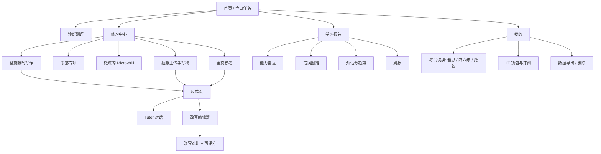
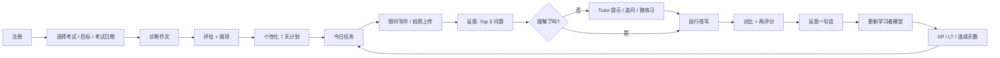
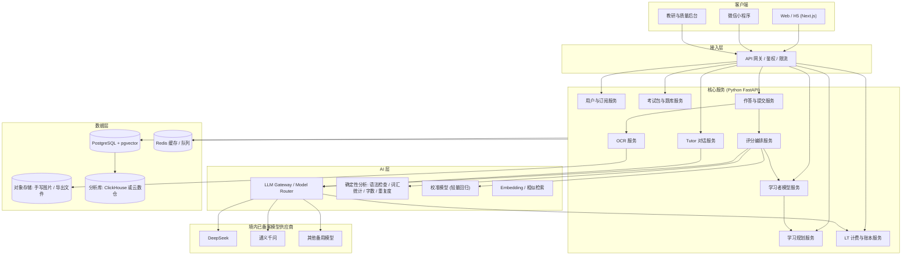
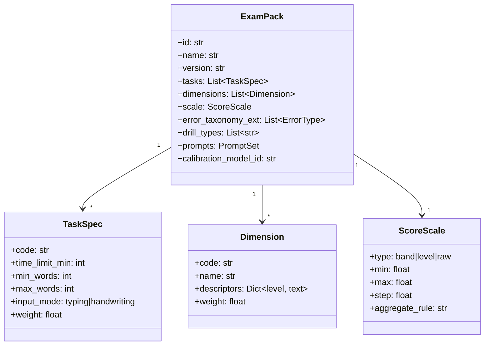
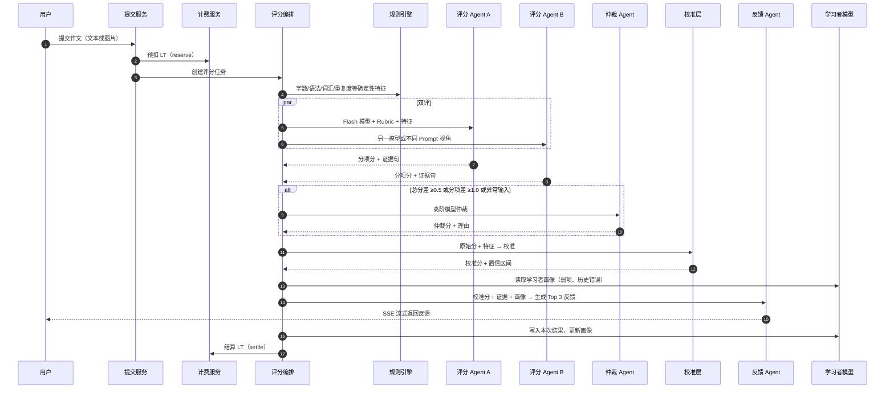
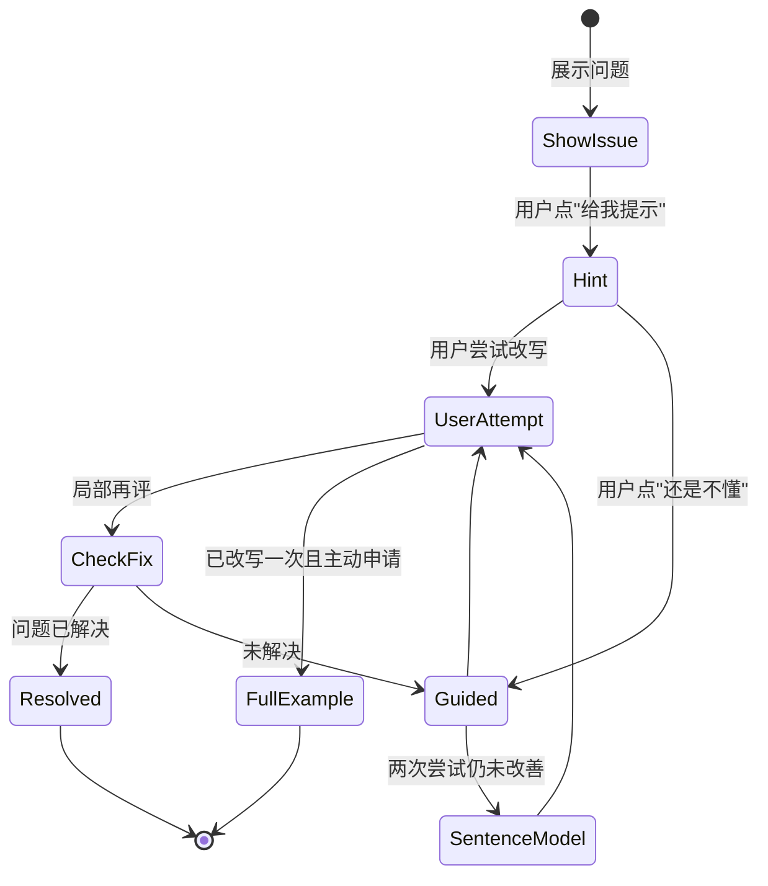
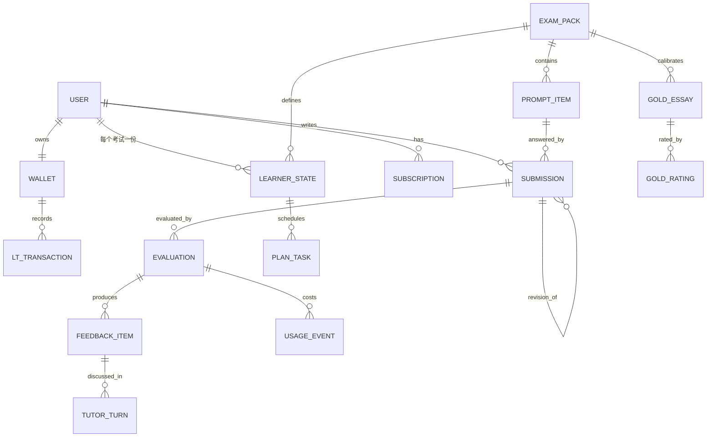

# 产品设计草案与技术原型方案

> 项目代号：**WriteMentor（暂定名）** ｜ 文档版本：v0.1 ｜ 日期：2026-10 ｜ 密级：内部
>
> 适用范围：雅思写作（首发）→ 大学英语四六级写作 → 托福写作。本文档面向产品、研发、教研团队，用于内部对齐 MVP 范围、系统架构、数据模型、接口与 Prompt 设计。本文档只做设计，不含实现代码。

---

## 1. 设计目标与原则

### 1.1 一句话定位

**一个记得你写过的每一篇作文、知道你为什么卡分、并每天决定你下一步该练什么的 AI 英语写作教练。**

评分是获客入口，**“长期学习者模型 + 改写闭环 + 自适应练习”才是留存与壁垒**。

### 1.2 设计原则

| # | 原则 | 含义 | 对设计的约束 |
|---|---|---|---|
| P1 | 一套引擎，多套考试 | 评分、画像、规划、计费为通用引擎；考试差异封装成“考试包（Exam Pack）” | 新增考试 ≈ 新增配置 + 题库 + 校准集，不改核心代码 |
| P2 | 先写后教，Hint-first | 用户必须先独立完成初稿；反馈逐级展开 | 范文默认锁定，改写后才解锁 |
| P3 | 少即是多 | 每篇只突出 Top 3 高影响问题 | 反馈 Agent 输出必须排序并截断 |
| P4 | 分数必须可校准、可解释 | 所有分数标注“AI 预估分 + 置信区间” | 不允许单次 LLM 调用直接出分 |
| P5 | 画像存“能力状态”，不存聊天记录 | 长期记忆 = 结构化能力向量 + 错误聚类 | 原文短期保存，长期只留抽象特征 |
| P6 | 合规内建 | 境内模型、AI 标识、数据可删除 | 架构层面默认满足 PIPL 与生成式 AI 规定 |
| P7 | 成本可计量 | 每次模型调用都有账本记录 | 统一 Usage Ledger，用户侧用 Learning Token（LT） |

---

## 2. 用户与场景

### 2.1 三条考试线的核心画像

| 维度 | 雅思（首发） | 四六级（第二阶段） | 托福（第三阶段） |
|---|---|---|---|
| 核心人群 | 本科高年级/研究生、年轻职场人 | 在校本专科生（大一至大三为主） | 本科生/研究生、国际学校高中生 |
| 当前水平 → 目标 | 写作 5.5–6.0 → 6.5–7.0 | 写作 5–8 档 → 11 档（总分过 425/500+） | 写作中等 → 申请门槛（如总分 100+） |
| 备考周期 | 4–12 周 | 考前 2–8 周（6 月/12 月两个高峰） | 4–12 周 |
| 作答形式 | 机考打字为主（另有纸笔选项） | **纸笔手写** | 机考打字 |
| 付费能力 | 中高 | 低–中，价格敏感 | 中高 |
| 关键诉求 | 可信预估分、突破 6 分瓶颈 | 不丢分、模板化表达升级、少花钱 | 新题型适应、限时表现 |
| 主要渠道 | 小红书/B站/留学机构 | 校园/学生社群/高校 B2B | 留学机构/国际学校/内容平台 |

> [!IMPORTANT]
> 四六级为纸笔考试，**“拍照上传手写作文 + OCR 识别 + 书写规范反馈”是四六级包的必备功能**，也同样服务于选择纸笔写作的雅思考生。

### 2.2 核心使用场景（Jobs to be Done）

1. **诊断**：“我现在到底是几分、差在哪？” → 诊断作文 + 四维/档次评估 + 能力雷达。
2. **日常练习**：“今天练什么最有效？” → 个性化今日任务（整篇 / 段落 / 微练习）。
3. **改写提升**：“看懂了反馈，但怎么改？” → 分级提示 + 改写 + 前后对比再评分。
4. **考前冲刺**：“考前 2 周如何稳定发挥？” → 限时模考 + 冲刺计划 + 高频错误清单。
5. **进度确认**：“我是否真的在进步？” → 周报、弱项掌握度曲线、预估分趋势。

---

## 3. 产品结构

### 3.1 信息架构



### 3.2 关键页面草图（低保真）

**① 首页 / 今日任务**

```text
┌──────────────────────────────────────────┐
│ [雅思 ▼]   距考试 34 天   目标 6.5        │
│ 当前预估：6.0（±0.5）  ▲0.5 vs 4周前      │
├──────────────────────────────────────────┤
│ 今日任务（约 35 分钟）                    │
│  1. 微练习：论点-理由-例证（TR）  5 min   │
│  2. Task 2 限时写作：教育类      40 min   │
│  3. 复盘：改写上周第 2 段        10 min   │
├──────────────────────────────────────────┤
│ 本周弱项：①例证不足 ②冠词误用 ③衔接重复  │
│ Learning XP 本周 420 · 连续 6 天 🔥       │
│ LT 余额 1,260                            │
└──────────────────────────────────────────┘
```

**② 写作编辑器（机考模拟）**

```text
┌──────────────────────────────────────────┐
│ Task 2 · 剩余 32:15 · 字数 186/250        │
├───────────────────┬──────────────────────┤
│ 题目              │ 作答区（禁用粘贴可选）│
│ Some people think │                      │
│ ...               │                      │
├───────────────────┴──────────────────────┤
│ [暂存]                    [提交并评估]   │
└──────────────────────────────────────────┘
```

**③ 反馈页（核心页面）**

```text
┌──────────────────────────────────────────┐
│ AI 预估：6.0（置信区间 5.5–6.5）[AI生成]  │
│ TR 6.0 | CC 6.0 | LR 6.5 | GRA 5.5        │
├──────────────────────────────────────────┤
│ 本篇最值得改的 3 个问题                    │
│ ❶ 第2段论点缺少具体例证（TR，影响大）      │
│    [给我提示] [问我问题] [示范一句]        │
│ ❷ 冠词错误 5 处，属于你的长期高频错误      │
│ ❸ "Moreover" 重复 4 次（CC）              │
├──────────────────────────────────────────┤
│ [开始改写]       范文🔒（改写后解锁）     │
└──────────────────────────────────────────┘
```

**④ 改写对比页**

```text
┌──────────────────────────────────────────┐
│ 初稿 6.0  →  改写 6.5   TR +0.5  GRA +0.5 │
│ ─ 原句（删除线） / + 新句（高亮）         │
│ 已解决：❶ ❸   未解决：❷（建议做冠词微练习）│
│ 反思：这次我学会了__________（必填一句）   │
└──────────────────────────────────────────┘
```

### 3.3 核心用户流程



---

## 4. 功能规划

### 4.1 版本路线

| 版本 | 时间（目标） | 考试线 | 关键交付 |
|---|---|---|---|
| v0.1 Alpha | 2027-03 | 雅思 Task 2 | 评分管线、反馈页、改写闭环、学习者模型 v1，100 人内测 |
| v0.2 Beta | 2027-04 ~ 05 | 雅思 Task 1 + 2 | 个性化计划、微练习、LT 钱包、管理后台，500–1,000 人闭测 |
| v1.0 公测 | 2027-05 中 | 雅思 | 支付上线、周报、数据导出删除、AI 标识 |
| v1.5 | 2027-09（赶 12 月四六级） | **四六级** | 四六级考试包、拍照 OCR、低价学期包、校园大使 |
| v2.0 | 2028-03 | 四六级 + 高校 B2B | 教师端、班级看板、作业布置 |
| v2.5 | 2028-06 | **托福** | 托福考试包（新版写作题型）、留学机构 B2B |
| v3.0 | 2029 | 扩展 | 口语模块、考研英语写作 |

### 4.2 MVP（v0.1–v1.0）功能清单

| 优先级 | 功能 | 说明 | 验收标准 |
|---|---|---|---|
| P0 | 入门诊断 | 考试、目标分、考试日期、当前水平自评 + 诊断作文 | 3 分钟内完成设置 |
| P0 | 限时写作编辑器 | 计时、字数、自动暂存、可选禁用粘贴 | 断网不丢稿 |
| P0 | 多维预估分 + 置信区间 | 雅思四维；四六级档次；托福 1–6 分 | 与专家共识 ±0.5 band 命中 ≥80% |
| P0 | Top 3 问题反馈 | 按“提分影响 × 置信度 × 是否长期弱项”排序 | 每条可定位到句/段 |
| P0 | 分级 Tutor 提示 | Hint → 追问 → 示范一句 → 完整示例 | 完整示例默认锁定 |
| P0 | 改写 Diff + 再评分 | 句级对比、问题解决状态 | P95 延迟 < 30 秒 |
| P0 | 错误图谱 / 弱项掌握度 | 跨作文的错误聚类与掌握度曲线 | ≥3 篇后可见 |
| P0 | 下一步推荐 | 自动生成下一项任务 | 推荐理由可解释 |
| P0 | LT 钱包与订阅 | 预扣—结算、失败不扣费、账单明细 | 账实一致 |
| P0 | 质量后台 | 抽检、仲裁、gold set 回归 | 每次模型升级前跑回归 |
| P0 | 合规底座 | AI 标识、隐私授权、导出/删除 | 删除 7 天内完成 |
| P1 | 周计划 / 连续天数 / 周报 | 提升留存 | — |
| P1 | Learning XP 排行榜 | 按学习行为排名，不按分数排名 | — |
| P1 | 专家人工复核加购 | 高分段/争议兜底 | — |
| P2 | 拍照 OCR | 四六级上线前必须完成 | 手写识别字准率 ≥95% |
| P2 | 教师端 | 高校/机构 B2B | — |

### 4.3 学习闭环设计细则

**(1) 反馈排序公式**

每条候选问题 $i$ 的优先级：

$$\text{priority}_i = w_1 \cdot \text{impact}_i + w_2 \cdot \text{confidence}_i + w_3 \cdot \text{recurrence}_i - w_4 \cdot \text{recent\_shown}_i$$

- `impact`：修正后预计提分（由评分 Agent 给出分项影响估计）
- `confidence`：问题判定置信度（双评一致性）
- `recurrence`：该错误类型在学习者历史中的出现频率
- `recent_shown`：最近 3 篇是否已重复提示（避免说教疲劳）
- 初始权重建议：$w = (0.4, 0.2, 0.3, 0.1)$，上线后用 A/B 实验调参

**(2) 四级干预（Intervention Ladder）**

| 级别 | 形式 | 示例 | 触发 |
|---|---|---|---|
| L1 Hint | 指出位置和方向 | “第 2 段的论点缺少什么支撑？” | 默认 |
| L2 Guided Question | 苏格拉底式追问 | “能举一个你身边的具体例子吗？” | 用户点“还是不懂” |
| L3 Sentence Model | 示范一句并解释 | 只示范 1 句，不给整段 | 用户两次尝试未改善 |
| L4 Full Example | 完整段落/范文 | 带 AI 生成标识 | 用户已改写一次或主动申请（消耗 LT） |

**(3) 微练习（Micro-drill）类型库**

| 类型 | 时长 | 针对维度 | 示例 |
|---|---|---|---|
| 论点扩展 | 5 min | TR / 内容 | 给出论点，补充理由 + 例证 |
| 衔接改写 | 3 min | CC / 连贯 | 去掉重复连接词，改用指代/结构衔接 |
| 词汇替换 | 3 min | LR / 词汇 | 把低阶词替换为准确搭配 |
| 句型改造 | 5 min | GRA / 语法 | 简单句合并为复合句 |
| 改错 | 3 min | GRA | 找出并修正个人高频错误（来自错误图谱） |
| 图表描述 | 8 min | 雅思 Task 1 | 写出概述句 + 2 个关键对比 |
| 邮件语气 | 5 min | 托福 Write an Email | 调整语气和格式 |
| 开头/结尾 | 5 min | 四六级 | 避免空洞模板，写出切题首段 |

**(4) 激励机制**

- **Learning XP** = 40% 完整闭环 + 30% 弱项掌握度提升 + 20% 连续学习 + 10% 反思/微练习；每日封顶，周一重置。
- 排行榜按考试和起始水平分组，昵称展示，奖励为 LT / 会员天数 / 专家复核券，不发现金。

### 4.4 计费体验（Learning Token）

| 动作 | LT 消耗 | 说明 |
|---|---:|---|
| 快速评分 | 50 | 只出分与简评 |
| 标准批改 | 80 | 分数 + Top 3 问题 |
| 深度 Tutor 闭环 | 200 | 评分 + 讲解 + 微练习 + 一次改写再评 |
| 全套模考 | 250 | 雅思 Task 1+2 / 托福写作全部任务 |
| 微练习 | 20–40 | — |
| 拍照 OCR | +10 | 叠加在批改之上 |

UX 规则：提交前显示预计消耗；调用失败自动返还；余额不足时引导购买加量包或降级为快速评分。四六级线采用更低价格的“学期包 / 考前冲刺包”（见商业计划书定价章节），同一 LT 体系通用。

---

## 5. 技术架构

### 5.1 总体架构



### 5.2 技术选型

| 层 | 选型 | 理由 |
|---|---|---|
| 前端 | Next.js（Web/H5）+ 微信小程序（Taro 或原生） | 雅思/托福用户偏电脑端；四六级用户偏手机与小程序 |
| 后端 | Python 3.12 + FastAPI + Pydantic v2 | AI 生态成熟；Pydantic 可直接约束 LLM 结构化输出 |
| 异步任务 | Redis + arq（或 Celery） | 评分为 10–30 秒的异步任务 |
| 实时推送 | SSE（Server-Sent Events） | 反馈逐段流式展示，降低感知延迟 |
| 数据库 | PostgreSQL 16 + pgvector | 关系数据 + 向量检索一体，降低运维 |
| 缓存 | Redis | 会话、限流、LT 预扣锁 |
| 对象存储 | 阿里云 OSS / 腾讯云 COS | 手写图片、导出文件，设置生命周期自动删除 |
| LLM 接入 | OpenAI 兼容协议的统一网关（自研轻量 Router，可参考 LiteLLM） | DeepSeek、通义等均提供 OpenAI 兼容接口，便于切换 |
| OCR | 云厂商手写英文 OCR（阿里云/腾讯云/百度）+ 多模态模型兜底 | 四六级手写稿识别 |
| 语法规则 | LanguageTool（自部署）+ 自建错误分类映射 | 确定性信号，降低幻觉、节约 token |
| 部署 | Docker + 阿里云 ACK / 腾讯云 TKE（初期可用单机 Docker Compose） | 境内部署，满足数据本地化 |
| 可观测性 | OpenTelemetry + Prometheus + Grafana + Langfuse（自部署） | 追踪每次 LLM 调用的成本、延迟、质量 |

### 5.3 考试包（Exam Pack）抽象：一套引擎支持三条考试线

考试差异全部通过声明式配置描述，核心引擎只认识“维度、任务、量表、错误分类”这些通用概念。



**三个考试包的关键配置对照**

| 配置项 | 雅思 IELTS Academic | 四六级 CET-4 / CET-6 | 托福 TOEFL iBT（2026 新版） |
|---|---|---|---|
| 写作任务 | Task 1 图表（20 min, ≥150 词）、Task 2 议论文（40 min, ≥250 词） | 短文写作 30 min；CET-4 120–180 词，CET-6 150–200 词 | Build a Sentence、Write an Email、Academic Discussion（以 ETS 最新官方说明为准） |
| 评分维度 | TR/TA、CC、LR、GRA（各 0–9） | 官方为整体印象评分；内部拆为切题、内容、结构、语言准确、语言丰富度 5 个子维度 | 内部拆为任务完成、观点展开、组织、语言使用 |
| 量表 | 0–9，0.5 步长；Task 2 权重为 Task 1 的 2 倍 | 15 分制，五个档次（2/5/8/11/14 分档）；占总分 15% | 新版 1–6 分（0.5 步长），过渡期同时提供 0–120 对照 |
| 作答形式 | 打字为主 / 纸笔可选 | 手写（需 OCR） | 打字 |
| 校准集要求 | ≥1,500 篇（公测前） | ≥1,000 篇（含手写扫描件） | ≥800 篇/每题型 |
| 特有错误类型 | 图表数据误读、立场不清 | 跑题、模板化空洞、书写/拼写 | 邮件语气与格式、讨论回应他人观点不足 |

> [!NOTE]
> 四六级官方评分为“整体评分（holistic）”，子维度为我们内部的诊断维度，用于生成可执行反馈；对外展示时以“档次 + 预估分”为主，子维度作为解释信息。

**考试包配置示例（YAML，示意）**

```yaml
id: cet4
name: 大学英语四级 · 写作
version: 2027.1
scale:
  type: level
  min: 0
  max: 15
  step: 1
  bands: [2, 5, 8, 11, 14]      # 档次中心分
  report_weight: 0.15            # 占总分 710 的 15%
tasks:
  - code: cet4_essay
    time_limit_min: 30
    min_words: 120
    max_words: 180
    input_mode: handwriting
dimensions:
  - {code: relevance,  name: 切题,       weight: 0.25}
  - {code: content,    name: 内容与论证, weight: 0.20}
  - {code: structure,  name: 结构与连贯, weight: 0.20}
  - {code: accuracy,   name: 语言准确性, weight: 0.20}
  - {code: range,      name: 语言丰富度, weight: 0.15}
error_taxonomy_ext: [off_topic, template_overuse, spelling_handwriting]
calibration_model_id: calib_cet4_v1
```

### 5.4 评分管线（Scoring Pipeline）



**关键设计点**

1. **确定性特征先行**：字数、句长分布、词汇多样性（MTLD）、学术词表覆盖率、LanguageTool 错误、重复连接词计数等，由规则计算后作为“证据”喂给 LLM，减少幻觉。
2. **双评 + 条件仲裁**：两个评分器使用不同模型或不同 Prompt 视角（如“考官视角”与“逐维度检查表视角”）；只在分歧时调用高阶模型，预计仲裁触发率 15–25%。
3. **校准层**：用 gold set 训练一个轻量模型（有序回归或 Isotonic Regression），输入 = 双评原始分 + 确定性特征，输出 = 校准分。它修正 LLM 的系统性偏差（如普遍高估低分作文）。按考试包、按任务分别训练。
4. **置信区间**：由双评分歧度、校准残差的经验分布、作文长度异常度综合得出；置信度低时显示更宽区间，并提示“可申请专家复核”。
5. **证据约束**：所有反馈必须引用原文句子编号（`sentence_id`），后端校验引用是否存在，不存在则丢弃该条反馈，防止“编造原文”。

### 5.5 学习者模型（Learner Model）

**数据结构**

```text
LearnerState(user_id, exam_pack_id)
├── dimension_mastery: {TR: 0.58, CC: 0.61, LR: 0.66, GRA: 0.49}   # 0–1 归一化
├── estimated_score: {mean: 6.0, ci_low: 5.5, ci_high: 6.5}
├── error_profile: [
│     {type: "article_misuse",   freq_ema: 0.42, last_seen: ..., trend: "flat"},
│     {type: "unsupported_claim", freq_ema: 0.35, last_seen: ..., trend: "down"},
│     ...]
├── topic_exposure: {education: 3, technology: 1, environment: 0, ...}
├── behavior: {avg_session_min, revision_rate, hint_level_avg, streak_days}
├── timing: {avg_words_per_min, time_overrun_rate}
└── goal: {target: 6.5, exam_date: 2027-06-12}
```

- **通用错误分类（Error Taxonomy）**：约 40 个通用类型（冠词、主谓一致、时态、搭配、论点无支撑、段落无主题句、连接词重复……），由各考试包追加特有类型。跨考试共享的通用类型使用户**从四六级升级到雅思/托福时画像可以迁移**，这是多考试线的重要协同。
- **更新算法**：每次评估后对各维度和错误类型做指数移动平均：

$$m_{\text{new}} = (1-\alpha)\, m_{\text{old}} + \alpha \cdot p_{\text{latest}}, \quad \alpha = 0.25$$

  改写后的再评分以较低权重（$\alpha = 0.10$）计入，避免“改写分”虚高画像。

- **预估分**：最近 5 篇校准分的加权平均（时间衰减）+ 置信区间；篇数少于 3 时只显示区间。
- **为什么不用大模型记忆**：结构化状态可解释、可调试、可迁移、可删除，也便于合规（原文可定期删除而画像保留）。

### 5.6 学习规划（Planner）

规划器每天为用户生成 3 项左右的任务，采用“规则打分 + 约束求解”的轻量方案，不依赖 LLM：

1. **候选生成**：从错误图谱 Top 5 弱项 × 练习类型库生成候选任务；加入“整篇练习”和“复盘旧作”候选。
2. **打分**：`score = 弱项严重度 × 距离考试紧迫度 × 预期提分 − 近期重复惩罚 + 话题覆盖奖励`。
3. **约束**：每日总时长 ≤ 用户设定（默认 35 分钟）；每周至少 2 篇整篇；考前 14 天切换为“模考 + 高频错误清单”模式。
4. **解释**：每项任务附一句理由，如“你最近 6 篇有 4 篇出现论点无例证”。

### 5.7 Tutor 对话状态机



- Tutor 回复强约束：不得替用户写整段（L4 除外）；每轮 ≤ 120 字中文解释；必须以问题或行动指令结尾。
- 越界防护：检测到“帮我写一篇”“代写”等意图时，引导回练习模式（产品定位为学习工具而非代写器）。

### 5.8 LLM 网关与模型路由

| 任务 | 默认模型档位 | 备用 | 预估 tokens（入/出） |
|---|---|---|---|
| 评分 Agent A/B | Flash 档（如 DeepSeek Flash 类、通义 Turbo/Plus） | 另一供应商同档模型 | 5k / 0.8k ×2 |
| 仲裁 | Pro 档 | 另一供应商 Pro 档 | 6k / 0.6k（约 20% 触发） |
| 反馈生成 | Flash 档 | Pro 档 | 4k / 1.2k |
| Tutor 每轮 | Flash 档 | — | 2k / 0.3k |
| 局部再评 | Flash 档 | — | 2k / 0.4k |
| OCR 兜底 | 多模态模型 | 云 OCR | 视图片大小 |

路由器职责：统一 OpenAI 兼容协议；超时与重试（同请求幂等，不重复计费）；按任务配置模型；供应商降级；**利用前缀缓存**（Rubric + 考试包说明放在固定前缀，命中缓存可显著降低输入成本）；每次调用写入 Usage Ledger。

### 5.9 计费账本（LT Ledger）

```text
预扣 reserve(user, est_LT, request_id)      # Redis 锁 + 数据库事务
  → 执行 AI 任务，记录每次模型调用的 usage_event
  → 成功：settle(request_id, actual_LT)      # 多退少不补（以预估为上限）
  → 失败：release(request_id)                # 全额返还
```

- `usage_event` 只追加不修改：`request_id, user_id, task_type, provider, model, model_version, input_tokens, cached_tokens, output_tokens, latency_ms, cost_cny, created_at`。
- 用户侧看到的是 LT 账单；运营侧看到的是真实成本，可按考试线、任务类型核算毛利。

---

## 6. 数据模型

### 6.1 实体关系



### 6.2 核心表（关键字段）

| 表 | 关键字段 | 说明 |
|---|---|---|
| `users` | id, phone_hash, wechat_openid, age_verified, consent_version, created_at | 手机号仅存哈希 + 加密密文 |
| `exam_packs` | id, version, config_json, status | 考试包配置版本化 |
| `prompt_items` | id, exam_pack_id, task_code, topic, difficulty, content, source_license | 题目来源与授权必须登记 |
| `submissions` | id, user_id, prompt_item_id, parent_submission_id, text, image_key, ocr_text, word_count, duration_sec, input_mode, purge_at | `parent_submission_id` 串起改写链；`purge_at` 控制原文到期删除 |
| `evaluations` | id, submission_id, raw_scores_json, calibrated_scores_json, ci_low, ci_high, adjudicated, model_versions, pipeline_version | 记录模型版本，便于回归与追溯 |
| `feedback_items` | id, evaluation_id, rank, dimension, error_type, sentence_ids, impact, status(open/resolved) | 反馈可定位、可追踪解决状态 |
| `tutor_turns` | id, feedback_item_id, level(L1–L4), role, content, ai_label | 所有 AI 输出带 `ai_label` |
| `learner_states` | user_id, exam_pack_id, state_json, updated_at | 长期画像（抽象特征） |
| `plan_tasks` | id, user_id, date, type, target_error_type, reason, status | 每日任务 |
| `wallets` / `lt_transactions` | balance；type(grant/purchase/reserve/settle/release), amount, request_id | 账本只追加 |
| `usage_events` | 见 5.9 | 真实成本 |
| `gold_essays` / `gold_ratings` | essay, exam_pack_id, task；rater_id, scores_json, round | 校准与回归基准集 |

### 6.3 数据保留策略

| 数据 | 默认保留 | 用户可控 |
|---|---|---|
| 作文原文 / 手写图片 | 180 天后自动删除（图片 30 天） | 可立即删除；可选择“永久保存到作品集” |
| 学习者画像（抽象特征） | 账号存续期间 | 注销即删除 |
| 用于模型改进的样本 | **仅在用户单独同意后**进入去标识化训练/校准池 | 可随时撤回 |
| 计费与交易记录 | 按财税法规要求保留 | 不可删除（法定义务） |

---

## 7. 接口设计（REST + SSE，示意）

| 方法 | 路径 | 说明 |
|---|---|---|
| POST | `/v1/auth/login` | 手机号/微信登录 |
| GET | `/v1/exam-packs` | 可用考试包列表 |
| PUT | `/v1/me/goals/{exam_pack_id}` | 设置目标分、考试日期 |
| GET | `/v1/prompts?exam=ielts&task=task2&topic=education` | 获取题目 |
| POST | `/v1/submissions` | 提交作文（文本或图片 key），返回 `submission_id` 与预估 LT |
| GET | `/v1/submissions/{id}/evaluation/stream` | SSE 流式返回评分与反馈 |
| POST | `/v1/feedback/{id}/tutor` | Tutor 对话一轮（指定干预级别） |
| POST | `/v1/submissions/{id}/revisions` | 提交改写稿，触发 Diff 与再评分 |
| GET | `/v1/learner/{exam_pack_id}/state` | 能力雷达、错误图谱、预估分 |
| GET | `/v1/plan/today?exam=ielts` | 今日任务 |
| GET | `/v1/wallet` / `/v1/wallet/transactions` | LT 余额与明细 |
| POST | `/v1/me/data-export` / `DELETE /v1/me` | 数据导出 / 注销删除 |
| GET | `/admin/v1/gold/regression?pipeline=v3` | 后台：跑 gold set 回归报告 |

**提交作文 – 请求/响应示例**

```json
// POST /v1/submissions
{
  "exam_pack_id": "ielts_ac",
  "prompt_item_id": "p_t2_edu_0042",
  "input_mode": "typing",
  "text": "Some people believe that ...",
  "duration_sec": 2280,
  "mode": "deep_tutor"
}
// 202 Accepted
{
  "submission_id": "sub_8f2c",
  "lt_reserved": 200,
  "stream_url": "/v1/submissions/sub_8f2c/evaluation/stream"
}
```

**SSE 事件序列**

```text
event: progress     data: {"stage":"analyzing"}
event: score        data: {"overall":6.0,"ci":[5.5,6.5],"dims":{"TR":6,"CC":6,"LR":6.5,"GRA":5.5},"ai_label":true}
event: issue        data: {"rank":1,"dimension":"TR","error_type":"unsupported_claim","sentence_ids":[7,8],"title":"第2段论点缺少具体例证","hint":"..."}
event: issue        data: {"rank":2, ...}
event: issue        data: {"rank":3, ...}
event: next_step    data: {"task_type":"drill_claim_support","reason":"近6篇中4篇出现该问题"}
event: done         data: {"lt_settled":200}
```

---

## 8. Prompt 设计

### 8.1 Prompt 分层

```text
[固定前缀 - 可缓存]
  1. 系统角色与行为约束（考官/教练身份、输出语言、禁止事项）
  2. 考试包 Rubric（官方公开描述的结构化改写 + 内部子维度定义）
  3. 输出 JSON Schema
  4. 少样本锚点（3–5 篇已校准的不同分数段样例摘要）
[动态部分]
  5. 题目与任务类型
  6. 作文（按句编号）
  7. 确定性特征（字数、语法错误列表、词汇统计）
  8. 学习者画像摘要（仅反馈/Tutor Agent 使用，评分 Agent 不看，避免评分偏见）
```

> [!IMPORTANT]
> **评分 Agent 不接触学习者画像和历史分数**，以免出现“锚定效应”（例如因为用户历史是 6 分就倾向给 6 分）。画像只用于反馈排序和教学策略。

### 8.2 评分 Agent（示意）

```text
SYSTEM:
你是一名严格遵循评分标准的 {exam_name} 写作评估员。你的任务只有评分，不提供教学建议。
规则：
- 逐一对照每个维度的等级描述，先列证据（引用句子编号），再给分。
- 分数必须符合量表：{scale_spec}。
- 不得因为作文长或使用高级词汇而自动加分；字数不足按规则处理：{word_rule}。
- 如果作文离题、为空、明显为非英语或疑似复制题目，设置 flags。
- 只输出符合 Schema 的 JSON。

RUBRIC:
{rubric_structured}

ANCHORS:
{anchor_summaries}

USER:
题目：{prompt_text}
作文（已按句编号）：
[1] ...
[2] ...
确定性特征：{features_json}
```

**输出 Schema（Pydantic 示意）**

```text
DimensionScore { code: str, score: float, evidence: [ {sentence_id: int, note: str} ], confidence: float }
EvalOutput {
  dimensions: [DimensionScore],
  overall: float,
  flags: [off_topic | under_length | memorized_template | non_english | empty],
  candidate_issues: [ {dimension, error_type, sentence_ids, impact_estimate} ]
}
```

### 8.3 反馈 Agent（示意）

```text
SYSTEM:
你是一名耐心的 {exam_name} 写作教练，面向中国学生，用简体中文讲解，例句用英文。
输入是已经确定的分数与候选问题（不得修改分数）。
任务：
1. 结合学习者画像，从候选问题中选出最值得改的 3 个，按提分影响排序。
2. 每个问题输出：标题（≤20字）、为什么扣分（≤60字）、L1 提示（不给答案）。
3. 若某问题是该学生的长期高频错误，明确指出“这是你最近 N 篇的共同问题”。
4. 不得给出完整改写段落；不得编造原文中不存在的句子。
```

### 8.4 Tutor Agent（示意）

```text
SYSTEM:
你在帮助学生修改一个具体问题：{issue}。当前干预级别：{level}。
- L1：只指出方向；L2：提出一个引导性问题；L3：示范一句并解释为什么；L4：可给完整段落并标注【AI示例】。
- 每次回复 ≤120 字中文，结尾必须是一个问题或一个明确的动手指令。
- 如果学生要求代写整篇，礼貌拒绝并引导其先写一个句子。
```

### 8.5 Prompt 工程规范

- 所有 Prompt 存入版本库（`prompts/{exam}/{agent}/vN.md`），与 `pipeline_version` 绑定。
- 任何 Prompt / 模型 / 校准模型变更，必须通过 gold set 回归（见第 9 节）才能上线。
- 输出统一走 JSON Mode / 结构化输出 + Pydantic 校验；校验失败重试 1 次，仍失败则降级为备用模型。

---

## 9. 评测与质量体系

### 9.1 Gold Set 建设

| 阶段 | 雅思 | 四六级 | 托福 |
|---|---|---|---|
| Alpha | 500 篇 | — | — |
| 公测前 | 1,500 篇 | 1,000 篇（含 300 份手写扫描） | 每题型 800 篇 |
| 持续 | 每月新增 100–200 篇（用户授权样本） | 每考季新增 300 篇 | 每月 100 篇 |

- 评分员：每篇两名经过统一培训的资深教师独立评分，分歧 ≥1 band（或四六级跨档）时第三人仲裁。
- 分数段分布需覆盖低、中、高分段，避免只集中在 5.5–6.5。

### 9.2 指标与上线门槛

| 指标 | 定义 | 门槛 |
|---|---|---|
| ±0.5 命中率 | AI 总分落在专家共识 ±0.5 band 内的比例（四六级：同档率） | ≥80%（四六级同档率 ≥75%，相邻档 ≥95%） |
| MAE | 平均绝对误差 | ≤0.4 band |
| QWK | 二次加权 Kappa | ≥0.75（参考人类评分员间一致性水平） |
| 分段偏差 | 各分数段平均误差 | 任一段系统性偏差 ≤0.25 |
| 反馈引用准确率 | 反馈引用的句子确实存在且问题成立（人工抽检） | ≥95% |
| 稳定性 | 同一作文重复评 5 次的标准差 | ≤0.25 band |

### 9.3 线上质量监控

- 每日抽检 1% 线上评分由人工复核；用户“分数异议”自动进入复核队列。
- 监控仲裁触发率、置信区间宽度、平均分漂移；异常时自动告警并可一键回滚 `pipeline_version`。

---

## 10. 非功能需求

| 类别 | 要求 |
|---|---|
| 延迟 | 首个分数事件 P95 < 15 秒；完整反馈 P95 < 30 秒；Tutor 单轮 P95 < 5 秒 |
| 可用性 | 核心服务 99.5%（MVP）；考前高峰期弹性扩容 |
| 并发 | 四六级考前一周峰值预估为平时 5–10 倍，评分任务走队列削峰 |
| 成本 | 深度闭环全口径 AI 成本目标 < ¥0.50；规划值 ¥0.30 |
| 安全 | 全链路 HTTPS；敏感字段加密存储；最小权限；后台操作审计日志 |
| 合规 | 境内部署与境内已备案模型；AI 生成内容显式与隐式标识；隐私政策与单独同意；数据导出/删除；未满 14 周岁用户需监护人同意（MVP 阶段面向成年人/大学生，注册时进行年龄确认） |
| 防滥用 | 粘贴检测与 AI 生成文本相似度提示（仅提示，不判定作弊）；频率限制 |

---

## 11. 原型实施计划（技术原型范围）

技术原型的目标是**用最小成本验证三件事**：①评分校准能达到门槛；②学习者模型能产生“可感知的个性化”；③同一引擎能通过配置接入第二个考试包。

| 周次 | 里程碑 | 产出 | 验证方式 |
|---|---|---|---|
| W1–2 | 雅思考试包 + Rubric 结构化 | 考试包配置、错误分类 v1、首批 200 篇 gold set | 教研评审 |
| W3–4 | 评分管线 v1 | 规则特征 + 双评 + 仲裁 + JSON 校验 | gold set 离线评测（MAE、QWK） |
| W5–6 | 校准层 + 反馈 Agent | 校准模型、Top 3 反馈、证据校验 | ±0.5 命中率；反馈引用准确率 |
| W7–8 | 学习者模型 + 规划器 + 改写闭环 | 画像更新、今日任务、Diff 再评 | 20 名种子用户连续 2 周使用 |
| W9 | 计费账本 + 管理后台 | LT 预扣/结算、回归报告 | 对账测试 |
| W10 | **四六级考试包 PoC** | 仅新增配置 + 100 篇 gold set + OCR 接入 | 不改核心代码完成接入即为通过 |

**原型团队**：后端 1、LLM 工程 1、前端 1（兼）、教研 1、兼职评分员 3–5 人。

---

## 12. 技术风险与对策

| 风险 | 对策 |
|---|---|
| LLM 评分不稳定 / 系统性偏差 | 双评 + 仲裁 + 校准层 + gold set 回归；温度设为 0；固定模型版本 |
| 模型供应商变价或下线 | OpenAI 兼容网关，至少两家供应商可切换；单供应商调用占比 < 80% |
| 手写 OCR 识别错误导致误判语法 | OCR 置信度低的词标灰并让用户确认；拼写错误与 OCR 错误分开统计 |
| 新版托福题型资料少 | 托福包延后到 2028 年中；先积累官方样题与授权语料，评分员按 ETS 公开评分描述培训 |
| 四六级考前流量洪峰 | 队列削峰、预扩容、高峰期降级为“快速评分”并提示 |
| Prompt 注入（作文中嵌入指令） | 作文作为数据块包裹并转义；系统提示声明忽略作文内指令；输出 Schema 强校验 |
| 用户依赖 AI 代写 | Hint-first、完整范文延迟解锁、粘贴提示、Tutor 拒绝代写 |

---

*附：本文档中所有考试格式信息以各考试主办方最新官方公布为准，上线前需由教研负责人逐项复核；所有分数均为“AI 预估分”，非官方成绩。*
