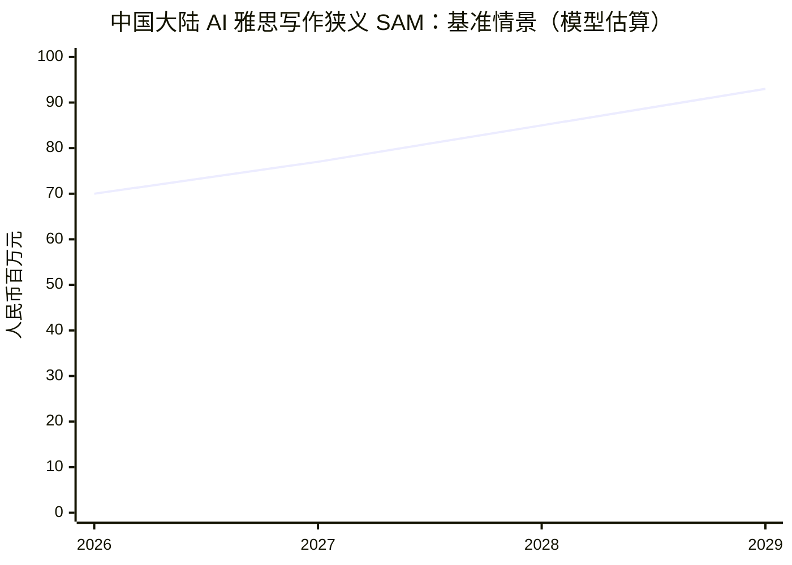
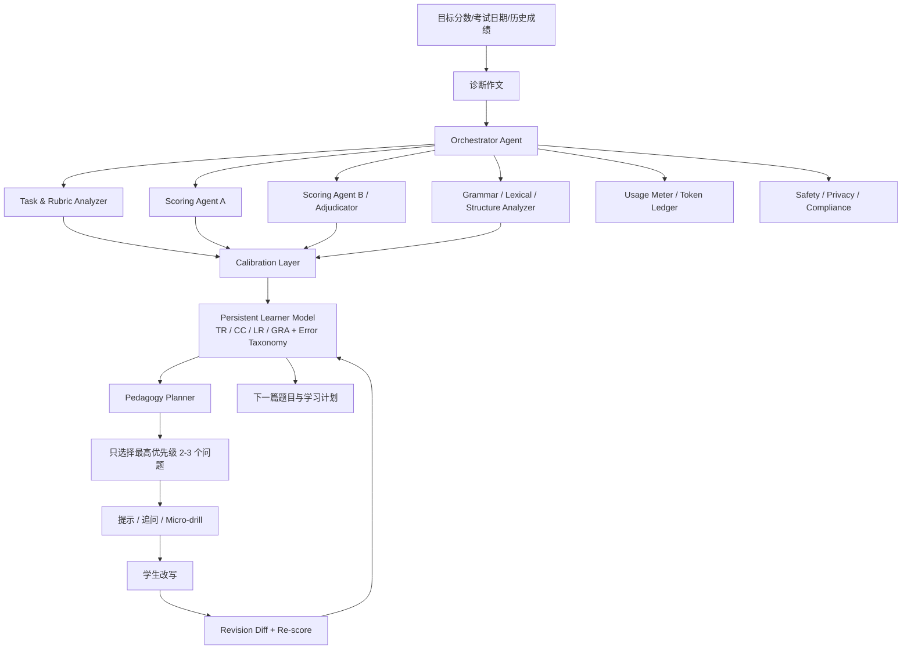
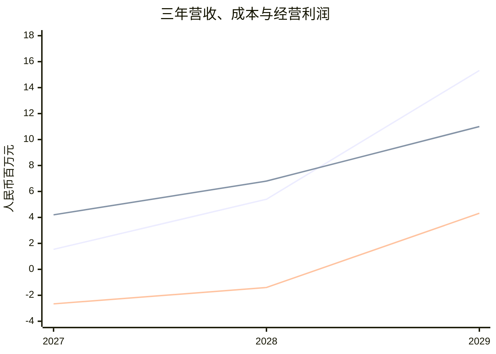
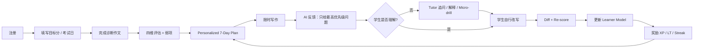
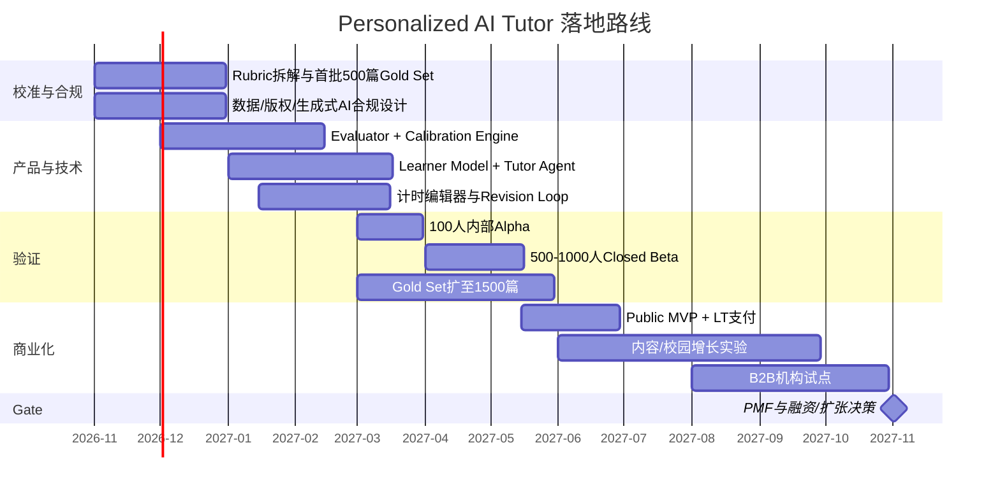

# 以“Personalized AI Tutor”为核心的雅思写作练习创业项目研究报告

## 执行摘要

**结论：建议落地，但应以“有条件启动、分阶段验证”的方式推进，而不是直接做成一个泛化的“AI 雅思批改器”。** 截至 2026 年，中国大陆雅思写作 AI 赛道已经出现一个非常强的官方基准产品：英国文化教育协会的 **BC 雅思写作模考 WriteUp**，其目前提供 0 元体验、6 次包 149.9 元，采用评分与反馈多模型协同、四大评分维度进一步拆成 16 个子维度，并公开说明题库不是直接复制正式考试原题。换言之，创业公司已经很难仅靠“AI 打分更快、更便宜”形成壁垒。citeturn19view0

真正值得切入的机会是：**把一次性的“作文批改”升级为跨数周持续记忆学生弱项、自动规划训练、监督改写并验证改写效果的 personalized tutor。** 这与当前官方产品和大多数批改工具的产品重心不同。IELTS 官方 2024–2025 中国大陆数据也表明，学术类考生平均总分为 5.9，写作为 5.7、口语为 5.5，而阅读为 6.2；输出型技能仍然是中国考生的重要难点。官方调查同时显示，超过半数考生采取多国联申，55%的受访职场人士曾遇到岗位申请或晋升要求雅思成绩的情况，说明雅思需求并不完全依赖单一留学目的地。citeturn14view2

行业技术条件已经成熟。艾瑞 2026 年报告显示，截至 2025 年底，中国生成式 AI 用户规模为 6.02 亿，普及率 42.8%；在其调查中，25%的成年学习者已经使用 GenAI 进行学习或备考。艾瑞进一步估计，2025 年成年人教育服务市场约 4,755 亿元，GenAI 产品服务覆盖率为 15%–20%，并预计 2026–2028 年覆盖率升至 25%–40%；其中实用语言学习被列为与 GenAI 高度适配、可广泛应用于写作批改和口语训练的场景。需要强调：这些是**广义成人教育市场数据，不是雅思写作市场规模**。citeturn15view0turn15view1

雅思本身也正在发生有利于数字练习产品的结构变化：IELTS 官方宣布，自 2026 年中开始停止传统纸笔整套考试，所有 IELTS 考试转向计算机交付，个别市场可提供 “Writing on Paper” 选项。这意味着限时打字、电脑端写作、实时字数与机考流程适应的重要性进一步提高。citeturn23view3

**市场规模需要特别谨慎。** 中国大陆官方公开资料中，目前未找到一个权威、持续披露的“中国大陆年度雅思唯一考生人数”，因此这一关键数据应标为**“未明确”**。近期媒体估计中国每年约有 85 万人次参加雅思考试；另一方面，“躺着学 AI 雅思”2025 年披露注册用户突破 20 万时曾称约占全国雅思考生的 40%，由此隐含的考生池约 50 万，但该数字属于企业/媒体口径，且“考生人数”与“考试人次”不能混为一谈。citeturn17search0turn17search5 因此，本报告采用 **50万–85万人/人次的市场池代理值，65万为基准**。

据此自下而上估算：

| 市场口径 | 关键假设 | 估算结果 | 可信度 |
|---|---|---:|---|
| 中国大陆年度 IELTS 考试相关人群 | 官方年度唯一考生数**未明确**；二手信息约 50万–85万 | 50万–85万 | 中低 |
| 广义 IELTS 备考 TAM 代理值 | 50万–85万人 × 年均备考支出 ¥2,000–8,000 | **约 ¥10亿–68亿元/年** | 低，仅用于边界判断 |
| AI 写作狭义 SAM | 50万–85万人 × 35%–55%付费渗透 × ¥150–350/年 | **约 ¥0.26亿–1.64亿元/年** | 中低 |
| AI 写作狭义 SAM 基准 | 65万人 × 45% × ¥240 | **约 ¥7,020万元/年** | 规划假设 |
| 本方案第三年 B2C SOM | 65万新增注册 × 8%付费 × 3个月 × ¥79/月 | **约 ¥1,232万元** | 经营目标 |

广义 TAM 的支出假设刻意压在传统机构高客单价之下：2026 年雅思官方报名费为 1,990 元，单科重考为 1,400 元；新东方广州大学雅思课程公开价格约为 16,800–29,800 元。因此，¥2,000–8,000 的“全市场平均备考支出代理值”只是一个建模区间，并非公开行业统计。citeturn22view7turn21view0

基准情况下，狭义 AI 写作 SAM 约 7,000 万元。这意味着：**如果永远只做“中国大陆雅思写作 AI”，项目更像一个可以做到千万级收入和正向现金流的垂直 SaaS/教育科技业务，而非天然的百亿级独角兽赛道。** 因此从一开始就应保留“雅思口语 → TOEFL/PTE → 学术英语写作/B2B 教学平台”的扩张接口。

本报告建议的核心战略是：

**P0：评分校准和个性化学习闭环；P1：低 CAC 获客与 B2B 渠道；P2：雅思口语及其他英语考试扩张。**

首年按精益但商业化标准计算，建议运营预算约 **420 万元人民币**，同时准备 **500万–550万元现金**以留出模型价格、投放和人员波动缓冲。基准财务模型预计 2027、2028 年分别经营亏损约 266 万、140 万元，2029 年营收约 1,532 万元、经营利润约 432 万元。模型最敏感的变量并不是 LLM token 成本，而是**免费转付费率、付费生命周期和 CAC**。

## 市场与用户

中国市场的核心需求不是“有没有作文可以写”，而是“**能否得到可信、即时、可以转化为下一步动作的反馈**”。官方写作练习材料已经非常丰富；British Council 免费提供 Academic Writing Task 1、Task 2 练习、官方样例和考官评论，而正式写作考查 Task 1 和 Task 2，两部分合计 60 分钟。citeturn18search2 因此，单纯增加题库的边际价值越来越有限。

更值得关注的是两个结构性变化。第一，中国大陆 2024–2025 学术类雅思考生平均写作 5.7 分，低于阅读 6.2 分；考生总体主要集中在 5.5–6.5 分区间。citeturn14view2 第二，从 2026 年中开始，IELTS 全面转向计算机交付，进一步强化了电脑端限时练习的必要性。citeturn23view3

**建议优先服务的核心画像**是“当前写作约 5.5–6.0、目标 6.5–7.0、距离考试 4–12 周的大学本科生/研究生”。这一群体的问题高度标准化，既有明确目标，又有足够练习频率，而且不需要 AI 解决过度复杂的 Band 8+ 边缘判断。其次是需要雅思用于研究生申请、交换项目或职业发展的年轻职场人士。官方 2025 年对 1,120 名中国大陆考生的调研显示，留学仍为重要用途，但职场价值已明显增加；受访职场人士中，55%曾遇到雅思作为申请或晋升“硬门槛”。citeturn14view2

第三类可以做但不建议 MVP 首发重点覆盖的是国际中学学生。一方面他们具有较强支付能力，另一方面未成年人隐私和家长同意会提高合规成本。特别是《个人信息保护法》明确规定，不满 14 周岁未成年人的个人信息属于敏感个人信息，处理时需要监护人同意并制定专门规则。citeturn22view3

**用户最核心的五个痛点**可以归结为：

| 痛点 | 现有解决方案的问题 | Personalized Tutor 的机会 |
|---|---|---|
| 不知道自己到底为什么卡在 5.5/6.0 | 单次总分解释力有限 | 建立 TR/CC/LR/GRA 长期能力向量 |
| 人工批改慢且贵 | 高频练习不可持续 | AI 做高频反馈，人类只处理争议/高阶问题 |
| AI 批改“说很多，但下一篇还是一样” | 没有长期记忆和训练规划 | 自动生成下一个弱项 micro-drill |
| 看懂反馈但不真正改写 | 反馈与学习行为脱节 | 强制 Draft → Feedback → Revision → Reflection |
| 临考才发现不适应机考 | 普通聊天框缺乏考试状态 | 真实计时、字数、Task 1/2 流程模拟 |

IELTS 官方自身对 GenAI 在考试准备中的研究也值得重视：2025 年官方研究认为，良好的 prompt 可以提高人机互动质量，但生成式 AI 仍存在上下文感知、偏差、可靠性和表现一致性方面的局限。citeturn18search11 因而产品绝不能把一个通用 LLM 的“Band 6.5”当作真值。

**付费习惯方面，公开、权威的中国雅思 AI 写作付费率数据目前未明确。** 但市场价格已经形成非常明显的“低价 AI—官方测评—真人培训”阶梯：

- BC WriteUp 的当前官方促销价为 6 次 ¥149.9，即约 **¥25/次**。citeturn19view0
- 2026 年 IELTS 大陆考试费为 **¥1,990**，单科重考 ¥1,400。citeturn22view7
- 新东方广州公开雅思课程约 **¥16,800–29,800**。citeturn21view0
- E2 Writing Intensive 海外学生价约 **US$99/90 天**，包含课程、AI marking 和 6 次写作反馈。citeturn20view1

因此，**¥39–129/月的 AI personalized tutor 位于明显的可接受价格空档**：它比传统课程便宜一个数量级，同时可以比每篇 ¥25 左右的官方专项测评支持更高练习频率。

由于权威机构尚未单独披露“中国雅思 AI 写作市场”历史规模，下面的趋势图是**本报告模型估算，而非第三方行业预测**。基准 2026 SAM 为 7,020 万元，2027–2029 仅假设年增长 10%；这一假设比艾瑞报告中 GenAI 教育覆盖率增长趋势更保守。艾瑞预计成年人教育 GenAI 产品覆盖率由 2025 年 15%–20%提升至 2026–2028 年的 25%–40%。citeturn15view1

**最重要的市场判断是：需求是真实的，但 writing-only 市场天花板有限。** “躺着学 AI 雅思”在 2025 年 7 月被报道已达到约 26 万注册用户和 12 万 MAU，说明中国考生接受 AI 自适应备考的速度可以非常快；但它做的是全科雅思而非写作单项，这也从反面说明，单独写作产品最终需要横向扩张。citeturn17search1

## 竞品分析

竞争已经从“人工老师 vs AI”升级为“**官方 AI、教育机构 AI、纯 AI 工具、AI+真人混合服务**”四类。

| 产品 | 市场/定位 | 核心功能 | 当前公开定价 | 优势 | 相对本项目的空档 |
|---|---|---|---|---|---|
| **BC IELTS WriteUp** | 中国大陆，官方专项产品 | 4 大评分维度、16 子维度；评分/反馈双模型；个性化报告；48 道自研题；机考模拟 | 0 元体验；6 次 **¥149.9** | 官方品牌、专家数据、评分可信度极强 | 跨多周 learner memory、自动训练计划、长期 agent tutor **官网未明确** citeturn19view0 |
| **躺着学 AI 雅思** | 中国，全科 AI 自适应 | 入门测、全科课程、题库、模考、自适应推荐、学习轨迹 | **未明确** | 全流程、自适应；2025 年报道约 26 万注册/12 万 MAU | 写作深度、评分校准数据及独立写作价格公开信息有限 citeturn17search1turn17search14 |
| **雅思哥** | 中国，课程+AI | 秒级四维评分、语法/词汇/结构逻辑反馈、人工教师补充 | AI 不单独售卖；课程价格视套餐，**独立价格未明确** | 内容教研和人工兜底；官方页面称 2025 AI 写作产品累计使用超 40 万次 | AI 被绑定课程，轻量 standalone 用户入口较弱 citeturn21view2 |
| **新东方** | 中国，传统高客单教育 | 课程、阶段测、作业、线上线下学习工具、学习管理师 | 广州公开班课约 **¥16,800–29,800** | 品牌、教师、渠道、线下服务 | 成本高、个体高频 AI tutor 可作为低价替代/补充 citeturn21view0 |
| **Cambridge Write & Improve** | 全球英语写作 | 自动反馈、修改后即时再反馈、进度曲线、CEFR | 基础版免费；IELTS Test Zone 月订阅当前具体价格 **未明确** | Cambridge 品牌；超过 200 万学习者；优秀 revision loop | 中国本地化、IELTS 长期能力建模及中文解释较弱/未公开 citeturn20view0 |
| **E2Language** | 全球，课程+AI+老师 | AI marking、完整课程、直播、详细写作反馈、1v1 | Express US$69；Writing Intensive US$99/90 天；更高套餐 US$169–359 | AI+真人混合体系成熟 | 客单高、产品较重，不适合中国用户高频微付费 citeturn20view1 |
| **Magoosh IELTS** | 全球综合在线备考 | 学习计划、课程、练习、作文评分 | 当前公开价格本次检索 **未明确**；1 个月套餐含 1 篇评分，6 个月最多 4 篇 | 完整备考内容和 study plan | 写作反馈频率相对低，持续 tutor 属性较弱 citeturn20view2 |
| **SmallTalk2Me** | 全球 AI 英语练习 | IELTS Task 1/2 四标准评分+口语 | 官网 2026 对比页面称 Pro 约 **US$15/月**，首篇免费；属厂商自报 | 即时、写作+口语一体 | 中国本地运营、中文教学体系、境内数据合规能力不突出/未明确 citeturn20view3 |

其中最值得创业者警惕的是 **BC WriteUp**。它不仅拥有官方信用，而且已经采用“评分模型和反馈模型分开”的多模型架构；官网还明确指出，其题库不直接照搬正式考试原题，而是由专家根据题型、话题和难度研发。citeturn19view0 因此，创业公司不应该把“多 Agent 评分”或者“不是直接复制真题”当作自身差异化，这些已经接近行业基准。

真正可以形成差异的功能矩阵如下：

| 能力 | 本项目目标 | BC WriteUp | Cambridge W&I | 躺着学 | 雅思哥 | E2 |
|---|:---:|:---:|:---:|:---:|:---:|:---:|
| IELTS 四维评分 | ✓ | ✓ | ✓/IELTS 区 | ✓/公开细节有限 | ✓ | ✓ |
| 跨作文长期学生模型 | **✓ 核心** | 未明确 | △ 进度记录 | ✓ | 未明确 | △ |
| 自动弱项训练计划 | **✓** | △ | △ | ✓ | △ | △ |
| Draft→反馈→改写→再评完整闭环 | **✓** | △ | ✓ | △ | △ | △ |
| 错误模式长期聚类 | **✓** | 未明确 | 未明确 | △ | 未明确 | 未明确 |
| Agent 主动追问“为什么这么写” | **✓** | 未明确 | 未明确 | 未明确 | 未明确 | 人师可实现 |
| 人工争议升级 | 可选 | 高分有机会人工复核 | 未明确 | 未明确 | ✓ | ✓ |
| 中国本地支付/中文反馈 | ✓ | ✓ | △ | ✓ | ✓ | △ |
| 用户级 token/credits 灵活计费 | **✓** | 次数包 | 订阅 | 未明确 | 课程绑定 | 套餐 |

所以推荐的定位不是：

> “比官方更准的 AI 雅思评分器”

而应该是：

> **“一个记得你过去 30 篇作文、知道你为什么一直卡在 6 分，并每天决定你下一步应该练什么的 AI 写作教练。”**

这一区别非常重要。**评分是获客功能，个性化训练闭环才应该成为留存功能和数据壁垒。**

## 产品与技术可行性

技术上完全可行，而且不建议从头训练一个大模型。更合理的方案是建立“**LLM orchestration + rubric calibration + learner memory + deterministic analytics**”的复合系统。

**评分层不应该只调用一次 LLM。** 官方 WriteUp 已公开采用评分与反馈模型分别承担不同任务；IELTS 官方对 GenAI 备考研究也提醒了模型可靠性和一致性问题。citeturn19view0turn18search11 推荐采用：

`作文 → evaluator A → evaluator B/条件仲裁 → calibration model → 反馈 agent`

只有当两个 evaluator 的总分差距 ≥0.5、某个分项差距 ≥1.0，或者输入存在异常时，才调用昂贵模型进行仲裁。这样能显著降低成本。

**个性化模型应存“能力状态”，而不是无限存聊天记录。** 每个用户维护一个类似下面的向量：

`LearnerState = {TR, CC, LR, GRA, topic_gap, grammar_error_clusters, lexical_patterns, timing, revision_response, confidence}`

例如系统发现一个学生最近 8 篇 Task 2 都存在“论点提出但例证不足”，那么下一篇不应再给完整作文，而应安排 5 分钟的“claim → reason → example”微训练。反之，如果语法已经连续 5 次稳定，则应降低相关训练权重。

建议采用指数移动平均或简单的 Bayesian mastery score 更新每个弱项，例如：

`mastery_new = 0.75 × mastery_old + 0.25 × latest_performance`

这类能力模型足够解释、容易 debug，也比“让大模型自己记住用户”可靠。

**教学交互应该刻意避免一上来给整篇范文。** 推荐四级 intervention：

`Hint → Guided Question → Sentence Rewrite → Full Example`

只有用户已经尝试修改或明确要求后才展示完整示例。这样可以减少“AI 帮我写”而不是“AI 教我写”的依赖。

### Token 计费的正确实现

不建议把供应商的 raw token 直接出售给学生。不同供应商的 input/output token 价格差异很大，模型还会持续更新，直接按 raw token 收费会导致用户无法预测价格。

推荐创建统一的 **Learning Token，简称 LT**：

| 产品动作 | 建议 LT |
|---|---:|
| 快速四维评分 | 50 LT |
| 标准批改 | 80 LT |
| 深度 Tutor：评分+解释+练习+一次改写 | 200 LT |
| Task 1+Task 2 全套限时模拟 | 250 LT |
| 单独 micro-drill | 20–40 LT |

定价可先测试：

| 套餐 | 月价 | LT | 建议对象 |
|---|---:|---:|---|
| Free | ¥0 | 100 | 获客/诊断 |
| Lite | ¥39 | 800 | 轻度自学 |
| Pro | ¥79 | 2,000 | 核心产品 |
| Sprint | ¥129 | 4,000 | 考前 30 天重度用户 |
| 加量包 | ¥25 | 500 | 超额使用 |
| 加量包 | ¥59 | 1,500 | 高频用户 |

其中 Pro 套餐隐含零售价约 **¥0.0395/LT**。200 LT 的完整 personalized tutoring loop 用户侧价值约 ¥7.9，而后台模型成本可以低至几角钱，因此有足够空间覆盖研发、内容、获客和人工 QA。

后台计费则应记录真实模型使用量：

`Cost = input_tokens × Pin + output_tokens × Pout + tool_calls + embedding + retry_cost`

每一次调用写入 immutable billing event，包括 `user_id、model_version、input_tokens、cached_tokens、output_tokens、latency、request_id、LT_reserved、LT_settled`。请求开始时预授权 LT，成功后结算；服务器重试不得重复收费。

### 模型调用成本

截至 2026 年 10 月的官方 API 价格显示，模型推理本身已经非常便宜。DeepSeek 官方价格页当前的 Flash/Pro 模型按照输入、输出、缓存和峰谷时段分别计价；以其峰时费率做保守规划，Flash 的 cache-miss 输入和输出价格约为 ¥2/百万 tokens 与 ¥8/百万 tokens，Pro 约为 ¥9/百万与 ¥27/百万 tokens。实际价格应在上线前重新锁定，因为 API 定价会变化。citeturn22view0 国际基准方面，Google 官方当前 Gemini 2.5 Flash 标准价格为 US$0.30/百万输入 token、US$2.50/百万输出 token，Flash-Lite 更低。citeturn23view1

本报告对一次“深度批改”的基准调用假设是：

| 成本假设 | 基准 | 合理区间 |
|---|---:|---:|
| Essay + rubric + learner profile 等输入 | 9,000 tokens | 6k–15k |
| 总输出 | 2,500 tokens | 1.5k–5k |
| Flash 类模型调用占比 | 80% | 60%–95% |
| 高阶/仲裁模型占比 | 20% | 5%–40% |
| 理论纯推理成本 | 约 ¥0.06/loop | ¥0.03–0.20 |
| 加入 retries、embedding、moderation、监控后的规划成本 | **¥0.30/loop** | **¥0.10–1.00** |

按照 80% Flash + 20% Pro、9k 输入 + 2.5k 输出估算，纯模型推理费用约只有几分钱至一角量级；本报告财务模型使用 **¥0.30/完整 loop**，已经预留较大安全系数。由此得出的核心判断是：

**LLM token 不是这个生意的最大成本。人力、评分校准、内容和 CAC 才是。**

技术团队反而应该避免“为了节约 0.1 元模型成本，牺牲评分一致性”。

质量上，公开上线前建议建立一套独立 **gold set**：Alpha 阶段至少 500 篇、正式公开前扩充到 1,500 篇以上，由两位相互独立、经过统一 rubric 培训的资深 IELTS 教师评分；分歧较大时由第三人仲裁。产品内部可设一个并非官方要求的商业质量门槛：

**≥80%的 AI 总分落在专家共识 ±0.5 band 内；MAE ≤0.4；不同 Task 和不同 band 区间不能出现明显系统性偏高。**

这里应始终使用“AI estimated band / 预估分”，不能宣传“官方成绩”。

## 商业模式与财务预测

最合理的商业模式不是纯订阅，也不是纯 token，而是：

**Freemium + 月度 LT 套餐 + 加量包 + B2B SaaS/API + 可选真人精批。**

其中 B2C 提供快速规模，B2B 提高收入稳定性。B2B 客户可以是留学机构、国际学校、英语培训机构和大学语言中心，收费方式可以按 active student/month 或调用量计费。真人精批不应成为核心交付模式，否则很快重新变成传统培训公司。

以下是完整的**关键假设表**。没有公开依据的均明确标为经营假设，而不是市场事实。

| 假设 | 2027/Y1 | 2028/Y2 | 2029/Y3 | 依据/性质 |
|---|---:|---:|---:|---|
| 年度新增注册用户 | 120,000 | 300,000 | 650,000 | **经营假设** |
| 免费→首次付费转化 | 6% | 7% | 8% | **经营假设** |
| 年度独立付费用户 | 7,200 | 21,000 | 52,000 | 模型计算 |
| 平均付费月数 | 2.5 | 2.7 | 3.0 | **经营假设**；考虑雅思备考周期短 |
| 月度 ARPPU | ¥69 | ¥74 | ¥79 | 根据 ¥39/79/129 套餐混合假设 |
| 单个 payer 收入生命周期 | ¥173 | ¥200 | ¥237 | 付费月数 × ARPPU |
| 全注册用户 B2C ARPU | ¥10.35 | ¥13.99 | ¥18.96 | 模型计算 |
| B2B 收入 | ¥0.30m | ¥1.20m | ¥3.00m | **经营假设** |
| 一次 deep correction 原始 token | 9k in / 2.5k out | 同左 | 同左 | 技术规划假设 |
| 模型 all-in 成本/完整 loop | ¥0.30 | ¥0.30 | ¥0.30 | 保守规划；敏感区间 ¥0.10–1.00 |
| Y3 全平台完整 loop 数 | — | — | 2.0m | 包含免费用户，经营假设 |
| Pro LT 零售价 | ¥0.0395/LT | 可调整 | 可调整 | ¥79÷2,000 LT |
| 目标 Y3 blended CAC/新 payer | — | <¥70 | **<¥60** | 经营 KPI |
| 狭义 SAM 基准 | ~¥77m | ~¥85m | ~¥93m | 2026 ¥70m 后假设每年 +10% |

前三年财务模型如下。它是**经营规划模型，而非会计预测**，未计所得税、融资费用和股权激励。

| 项目 | 2027 | 2028 | 2029 |
|---|---:|---:|---:|
| 新注册用户 | 120,000 | 300,000 | 650,000 |
| 付费转化率 | 6% | 7% | 8% |
| 独立付费用户 | 7,200 | 21,000 | 52,000 |
| 平均付费月数 | 2.5 | 2.7 | 3.0 |
| 月 ARPPU | ¥69 | ¥74 | ¥79 |
| **B2C 收入** | **¥1.242m** | **¥4.196m** | **¥12.324m** |
| B2B/API 收入 | ¥0.300m | ¥1.200m | ¥3.000m |
| **总营收** | **¥1.542m** | **¥5.396m** | **¥15.324m** |
| 人力 | ¥2.25m | ¥3.40m | ¥5.00m |
| 技术/API/云服务 | ¥0.45m | ¥0.75m | ¥1.50m |
| 内容、客服、教研 | ¥0.35m | ¥0.70m | ¥1.20m |
| 市场营销 | ¥0.90m | ¥1.60m | ¥2.80m |
| 法务、合规、行政 | ¥0.25m | ¥0.35m | ¥0.50m |
| **总经营成本** | **¥4.20m** | **¥6.80m** | **¥11.00m** |
| **经营利润** | **-¥2.658m** | **-¥1.404m** | **¥4.324m** |
| 经营利润率 | -172% | -26% | 28% |

图中三条线依次为**营收、成本、经营利润**：

该模型大约到第三年才能稳定越过盈亏平衡，因此首两年累计经营亏损约 **406 万元**。考虑现金流时点、投放波动和 20% 左右安全垫，建议实际融资/现金储备至少 **550万–650万元**，而不是只准备第一年 420 万元。

更关键的是敏感性。下面展示 2029 年在不同**转付费率 × 平均付费月份**下的经营利润，其他条件保持基准不变，单位为百万元：

| Y3 转付费率 ↓ / 平均付费月数 → | 2.0个月 | 3.0个月 | 4.0个月 |
|---|---:|---:|---:|
| **5%** | -2.87 | -0.30 | +2.27 |
| **8% 基准** | +0.22 | **+4.32** | +8.43 |
| **11%** | +3.30 | +8.95 | +14.59 |

这张表揭示了本项目真正的商业风险：**如果转化只有 5%，且用户只买两个月，业务会长期亏损；模型 token 再便宜也救不了它。**

其他变量的单因素敏感性如下：

| Y3变量 | 悲观 | 基准 | 乐观 | 对 Y3 利润的影响 |
|---|---:|---:|---:|---:|
| 月 ARPPU | ¥59 | ¥79 | ¥99 | ¥1.20m / **¥4.32m** / ¥7.44m |
| LLM all-in / deep loop | ¥1.00 | ¥0.30 | ¥0.10 | ¥2.92m / **¥4.32m** / ¥4.72m |
| 转付费率 | 5% | 8% | 11% | -¥0.30m / **¥4.32m** / ¥8.95m* |

\*该行保持平均付费月份为 3.0。

可见即便模型成本从 ¥0.30 上升到 **¥1/次，增加超过 3 倍**，第三年仍有约 292 万元经营利润；而转付费率下降几个百分点就可能消灭全部利润。因此首要优化对象应当是**学习效果、产品留存和分发效率，而不是疯狂压模型价格**。

## 运营、增长、合规与风险

增长上，项目不能依赖长期高成本信息流广告。雅思是典型的“目标明确、备考周期短、每年不断换新用户”的市场，如果每一届用户都重新买流量，LTV 很难支撑 CAC。

推荐增长飞轮为：

`免费诊断 → 可分享能力雷达 → 个性化 7 天计划 → 改写前后对比 → 学习成果分享 → 邀请好友得 LT → 新用户诊断`

渠道优先顺序建议是：**内容 SEO/搜索意图 > 小红书/B站真实作文拆解 > 校园 ambassador > 留学机构/国际学校 B2B > performance ads**。广告只应该在已经证明 cohort LTV/CAC ≥3 后放量。

Leaderboard 不应按“谁的 Band 分最高”排名，否则最强用户天然占优，而且用户可能通过粘贴 AI 文章刷榜。建议排名 **Learning XP**：

`40% 完整训练闭环 + 30% 弱项 mastery 提升 + 20% 连续学习 + 10% 反思/微练习`

每周 reset，并按照起始水平或目标 Band 分组。每日 XP 设置上限，榜单采用昵称且默认不公开真实姓名。奖励最好是 LT、一次专家复核券或会员天数，不建议发现金。这样 leaderboard 激励的是**行为改善，而不是分数攀比**。

北极星指标建议定义为：

**Weekly Completed Deliberate-Practice Loops：每周完成“独立初稿 → 查看反馈 → 自己改写 → 再评 → 反思”的完整循环数。**

关键 KPI 建议设置以下门槛：

| 类别 | KPI | 上线后 6–12 个月目标 |
|---|---|---:|
| 学习质量 | AI 与专家共识 ±0.5 band 命中率 | ≥80% |
| 产品激活 | 新用户 24h 内完成首个完整 revision loop | ≥55% |
| 学习行为 | 收到反馈后进行实际改写 | ≥60% |
| 留存 | Activated user D30 | ≥20% |
| 使用 | WAU 平均完整 loop | ≥2/周 |
| 商业 | Free→paid | 首年 ≥6% |
| 商业 | Payer lifetime | ≥2.5个月 |
| 单位经济 | LTV/CAC | Y2 前达到 ≥3 |
| 获客 | Y3 blended CAC | ≤¥60 |
| 技术 | P95 深度反馈延迟 | <30秒 |
| 技术 | 完整 loop AI 成本 | <¥0.50 为目标 |

合规方面，中国大陆上线必须从架构阶段设计，而不是发布前补协议。

**个人信息保护。** 用户作文很容易主动包含学校、家庭、健康、宗教、财务经历等私人内容。根据《个人信息保护法》，敏感个人信息需要特定目的、充分必要性和严格保护措施；向境外提供个人信息还涉及告知、单独同意及相应跨境机制。citeturn22view3 因此建议默认采用境内模型/境内部署，原始作文短期存储，长期只保留抽象后的 error features 和学习状态。用户应能一键导出、删除数据。

若调用境外模型，不应因为规模小就认为“无需合规”。2024 年《促进和规范数据跨境流动规定》确实规定，非关键信息基础设施运营者一年向境外提供少于 10 万人的非敏感个人信息时，可以免于安全评估、标准合同和认证等部分机制，但仍需履行告知、单独同意以及个人信息保护影响评估等义务。达到更高数量或涉及敏感个人信息时适用条件更严格。citeturn22view6

**生成式 AI 备案/登记。** 国家网信办公告明确提出，已上线的生成式 AI 应用或功能应在显著位置或产品详情页面公示所使用的已备案生成式 AI 服务、模型名称和备案号。citeturn22view4 因而在中国市场最简单的 MVP 路径通常是选用已完成相关备案/登记的境内底层模型，并由专业法律顾问确认产品自身义务。

**AI 内容标识。** 《人工智能生成合成内容标识办法》自 2025 年 9 月 1 日施行，对 AI 生成合成内容标识提出要求。citeturn22view5 应把“AI Tutor generated”“AI example”等标签直接纳入内容层和导出层，而不是让用户误以为范文来自真人考官。

**版权和商标。** IELTS、IELTS logo 和“雅思”属于受保护注册商标。citeturn18search13turn23view3 产品品牌不建议直接命名为“XX 雅思官方 AI”或视觉模仿官方；宣传应明确“独立备考工具、非 IELTS 官方产品”。题库也不要依赖未经许可复制《剑桥雅思》图表、全文真题、用户回忆题。BC WriteUp 自己公开采取“根据题型结构、话题和难度自主研发，而非直接照搬正式题目”的方式，这也是创业产品最安全的内容路线。citeturn19view0

**考试作弊和学习伦理。** 产品应设计为练习工具，而不是“代写器”。默认交互顺序应要求用户先写，再获得 hint 和反馈；完整范文应延后展示。宣传上避免“押题”“预测命中”“保 7 分”等承诺。对于学校 B2B 版本，可以记录“是否使用生成式重写”的 provenance，方便教师区分学生原创与 AI 辅助内容。

风险矩阵如下：

| 风险 | 概率 | 影响 | 缓解措施 | 关键停止/转向信号 |
|---|---|---|---|---|
| AI 分数不可信 | 高 | 极高 | 双评+仲裁、gold set、置信区间、人类抽检 | ±0.5 命中率长期 <75% |
| BC 官方产品压制 | 高 | 高 | 不竞争“官方可信度”，转向持续 tutor 和记忆 | 用户只为一次评分付费、不愿持续使用 |
| CAC 高于 LTV | 高 | 极高 | SEO、校园、referral、B2B，严格控制广告 | 连续两 cohort LTV/CAC <2 |
| writing-only TAM 太小 | 中高 | 高 | 预留 speaking、TOEFL/PTE、B2B 扩展 | MAU 达规模后 ARPU 仍无法提高 |
| 用户只看反馈、不改写 | 高 | 高 | 产品强制 revision loop，奖励改写而非打分 | Revision rate <40% |
| 版权/商标投诉 | 中 | 高 | 原创题库、内容 license、法务审查 | 被要求下架核心题库 |
| 数据跨境/隐私问题 | 中 | 极高 | 境内优先、最小化存储、PIA、删除机制 | 模型架构无法满足数据要求 |
| 模型供应商变价/降质 | 中 | 中 | Model Router、多供应商、benchmark regression | 单供应商占调用 >80% |
| AI 让学生形成依赖 | 中 | 高 | Hint-first，完整答案延迟解锁 | AI 生成文本复制率过高 |
| 雅思需求季节性 | 高 | 中 | B2B、其他英语考试、年付机构合同 | 单月收入波动过大 |

## MVP、预算与落地路线图

MVP 应该极度克制。**不要一开始做听说读写全科，不要做直播课，不要做大社区，不要训练自有基础大模型。**

首发版本只需要证明一件事：

> “长期使用这个 tutor 的学生，会比只看单篇 AI 批改的学生更频繁地完成有效改写，而且愿意持续付费。”

建议 MVP 功能如下：

| 优先级 | MVP 功能 | 验证目的 |
|---|---|---|
| P0 | 入门诊断：考试日期、目标 Band、当前水平 | 建立 learner profile |
| P0 | Task 1 / Task 2 限时写作编辑器 | 对齐 2026 机考环境 |
| P0 | IELTS 四维 estimated score + confidence | 核心诊断 |
| P0 | 每篇只突出 Top 3 高影响问题 | 避免反馈过载 |
| P0 | 句子/段落级解释与 Hint-first tutor | 形成教学价值 |
| P0 | Revision Diff + 再评分 | 形成学习闭环 |
| P0 | 长期 Error Map / 弱项图谱 | 核心差异化 |
| P0 | Personalized Next Exercise | 验证 personalization |
| P0 | LT 钱包、订阅、用量账单 | 验证商业模式 |
| P0 | 质量管理后台 + 人工仲裁 | 防止评分事故 |
| P0 | 数据删除/导出/AI 标识 | 合规底座 |
| P1 | Weekly plan / streak | 提升留存 |
| P1 | Leaderboard | 增长实验 |
| P1 | 人工专家加购 | 高 Band/争议兜底 |
| P2 | 口语 | PMF 后扩张 |
| P2 | TOEFL/PTE | 市场扩张 |

技术团队建议首年控制在 **6 名左右核心 FTE + 外部兼职专家**：

| 角色 | 人数 | 主要职责 |
|---|---:|---|
| Founder / Product | 1 | PMF、用户研究、产品 |
| Full-stack / Backend | 2 | 编辑器、账号、支付、数据系统 |
| LLM/ML Engineer | 1 | evaluator、router、calibration、eval |
| IELTS Assessment / Curriculum Lead | 1 | rubric、训练体系、gold set |
| Growth / Operations | 1 | 内容、校园、用户运营 |
| 兼职 IELTS raters | 3–5 | gold set、争议样本、人评 |
| 法务/隐私顾问 | 外包 | PIPL、生成式 AI、版权 |

首年 **420 万元**预算建议如下：

| 预算类别 | 年预算 | 占比 | 主要内容 |
|---|---:|---:|---|
| **人力** | **¥2.25m** | 53.6% | 6 人左右核心团队、社保及部分专家 |
| **技术** | **¥0.45m** | 10.7% | LLM API、云服务器、数据库、监控、支付、安全 |
| **运营/教研/内容** | **¥0.35m** | 8.3% | gold set、专家评分、题库、客服 |
| **市场** | **¥0.90m** | 21.4% | 内容、校园 ambassador、KOL、有限广告测试 |
| **法务/合规/行政** | **¥0.25m** | 6.0% | 隐私、商标、合同、财会 |
| **合计** | **¥4.20m** | 100% | 不含融资成本 |

其中，最不应该省的是 gold set 和评测。即使 API 每次只花几角钱，**没有可信校准集的 AI 评分产品本质上仍是一个 prompt demo。**

建议用户流程如下：

从当前 2026 年 10 月启动，建议路线图：

其中应设置四个硬性 Gate：

**Alpha Gate：** AI 与专家 ±0.5 band 命中率至少 80%，严重 hallucination 接近零，否则不开放付费。

**Beta Gate：** 首次 feedback 后 revision rate ≥50%，否则说明产品仍然只是“评分器”，没有形成 tutor 行为。

**Commercial Gate：** free→paid ≥5%，D30 ≥20%，至少有一个套餐能稳定产生 ¥150 以上 payer 生命周期收入。

**Scale Gate：** 连续至少两个 cohort 的 contribution LTV/CAC ≥3；不达标时禁止大规模广告投放，应优先优化 organic/B2B 或提高产品价值。

## 结论与主要参考来源

**最终建议：落地，评级为“GO — 但必须以校准质量和留存闭环为前置条件”。**

从技术、市场时机和用户痛点看，这个项目具备成立条件。中国 GenAI 教育渗透持续上升，成年学习者已经大量把 AI 用于学习和备考；IELTS 又在 2026 年全面向计算机交付迁移，写作是中国考生相对薄弱的输出技能。citeturn15view0turn15view1turn14view2turn23view3

但这个项目**绝对不应该以“我们也能给 IELTS 作文打分”作为创业命题**。官方 WriteUp 已经有官方数据、16 子维度、多模型评分和约 ¥25/次的价格。citeturn19view0 Cambridge Write & Improve 也已经验证“写作—反馈—修改—看进步”的基础循环，并拥有超过 200 万学习者。citeturn20view0 E2 和雅思哥则证明了 AI+真人混合模式也并不新鲜。citeturn20view1turn21view2

因此唯一值得创业的核心壁垒应该是：

**“长期 learner model + 高质量评分校准 + adaptive deliberate practice + 极低摩擦的持续改写行为。”**

优先级建议明确为：

**P0：可信评分、长期用户模型、Revision Loop。**  
没有这三件事，产品只是 ChatGPT wrapper。

**P1：低 CAC 获客与 B2B。**  
财务敏感性显示，转化率和付费持续时间对利润的影响远高于模型 token 成本。绝不能在 LTV/CAC 未验证前靠买量制造增长。

**P2：口语与其他考试扩张。**  
写作单项预计可以建立千万级业务，但本报告的自下而上估算显示，狭义中国 AI 雅思写作 SAM 基准约只有 7,000 万元量级；长期要做更大的公司，应将 learner model 抽象为英语输出能力平台，再扩向 IELTS Speaking、TOEFL/PTE、学术英语写作和 B2B 教学场景。

**首要风险并不是大模型技术。** 首要风险依次是：  
**评分可信度 → 用户是否真正改写 → CAC/LTV → writing-only 市场天花板 → 数据与版权合规。**

最关键的投资/继续决策点是 **2027 年闭测结束时**。若此时同时满足“±0.5 band 命中 ≥80%、revision rate ≥50%、D30 ≥20%、free→paid ≥5%”，则值得继续投入 500万–650万元级别资金并进入规模化阶段；若评分准确但 revision/留存差，则应停止把产品定位为 tutor，重新验证教学闭环；若留存好但 CAC 高，应转 B2B；若写作 PMF 非常好但用户生命周期仍天然只有两三个月，则应尽快扩展口语及其他考试，而不是试图用更多广告解决结构性 LTV 问题。

**主要参考来源与链接（点击引文即可访问原始来源）：**

| 来源 | 主要用途 |
|---|---|
| British Council：《2024-2025中国大陆地区雅思考生成绩大数据报告》 | 中国考生平均成绩、写作痛点、1,120 人考生调研、职场用途 citeturn14view2turn17search15 |
| IELTS 官方：2026 test delivery update | 2026 年中起转向全计算机 IELTS citeturn23view3 |
| BC IELTS：中国大陆 2026 考试费用 | ¥1,990 考试费、¥1,400 单科重考等 citeturn22view7 |
| BC IELTS WriteUp 官方页 | 149.9 元/6 次、16 子维度、多模型评分/反馈、题库策略 citeturn19view0 |
| IELTS 官方 GenAI 备考研究 | GenAI prompt、可靠性、偏差和一致性限制 citeturn18search11 |
| 艾瑞咨询《2026年中国GenAI+教育行业发展报告》 | 中国 GenAI 用户、成人教育规模、GenAI 教育渗透率 citeturn15view0turn15view1 |
| Cambridge Write & Improve | 免费写作反馈、revision、progress graph、用户规模 citeturn20view0 |
| E2Language 官方支持文档 | IELTS 套餐、AI marking、写作反馈及定价 citeturn20view1 |
| 新东方网 | 中国传统雅思课程公开价格区间及服务结构 citeturn21view0 |
| 雅思哥官网 | AI 写作功能、人工兜底及“不单独售卖”模式 citeturn21view2 |
| 多知网：“躺着学 AI 雅思”访谈 | 注册用户、MAU、AI 雅思产品市场验证 citeturn17search1 |
| 上观新闻/解放日报相关市场报道 | 中国大陆约 85 万雅思考试人次的二手估算；非官方口径 citeturn17search0 |
| DeepSeek API 官方定价 | 国内模型 token 成本基准 citeturn22view0 |
| Google Gemini API 官方定价 | 国际模型成本基准 citeturn23view1 |
| 《中华人民共和国个人信息保护法》 | 敏感信息、未成年人、跨境个人信息要求 citeturn22view3 |
| 国家网信办：生成式 AI 已备案信息公告 | 应用展示模型名称和备案号要求 citeturn22view4 |
| 国家网信办：《人工智能生成合成内容标识办法》答记者问 | AI 内容标识，自 2025-09-01 实施 citeturn22view5 |
| 国家网信办：《促进和规范数据跨境流动规定》 | 数据出境规模阈值及相关义务 citeturn22view6 |
| IELTS / British Council 商标声明 | IELTS、雅思及 logo 的注册商标保护 citeturn18search13turn23view3 |