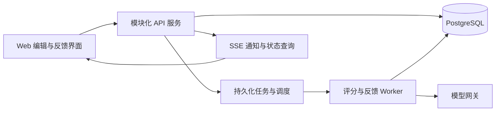

# 当前产品与架构总览

文档版本：0.2-draft。更新：2026-10-23。阶段：MVP-1 规格准备完成，尚未实现。维护：AG-PLAN 起草，创始人批准（见 [团队与组织](organization.md)）。

## 产品目标

服务准备雅思 Academic Task 2 的成年邀请用户，完成一次独立初稿、理解反馈、自主改写和查看对比。首阶段检验“流程可完成、反馈可理解、评分可评测”；不能据此声称已证明长期提分。

闭环完成定义：同一用户、同一题目，初稿与第一份有效改写稿均完成评估，比较结果可用，且用户打开对比页。仅点击改写、提交空稿或模型完成调用均不算完成。

## 范围

包含：邀请登录与同意记录、原创/授权题目、Web 编辑与草稿恢复、版本化评分、最多三个有证据的问题、L1/L2/L3 提示、一次改写、对比与问题处理状态、成本与事件记录、用户隔离、导出删除、最小评测与运营脚本。

暂缓：Task 1、四六级、托福、小程序、OCR、长期能力画像、自动学习计划、微练习库、完整范文 L4、反思必填、排行榜、订阅支付、LT 钱包、完整质量后台。后续恢复条件见 [路线图](roadmap.md)。

## 首阶段架构

沿用原方案的 Next.js、Python/FastAPI、PostgreSQL 与 Redis 方向，具体依赖版本和任务库在 MVP-001 通过实现决策固定。逻辑模块先放在一个后端部署单元中，Worker 可独立运行；目前不拆成多个微服务，不引入向量检索或分析数仓。

| 边界 | 负责的事实 | 规格 |
|---|---|---|
| 作答 | 用户、题目、可编辑草稿、不可变提交版本 | [作答](specs/submission.md) |
| 评估 | 评分配置、原始评分、校准、结果版本 | [评分](specs/scoring.md) |
| 教学 | 问题证据、提示级别、提示使用记录 | [反馈与 Tutor](specs/feedback-tutor.md) |
| 改写 | 首次改写关联、对比、问题解决状态 | [改写](specs/revision.md) |
| 运行支撑 | 任务、权限、幂等、用量、删除与事件 | [运行支撑](specs/platform.md) |

业务状态保存在数据库，浏览器 SSE 连接不是任务存活条件。所有跨服务边界以用户与资源归属校验为前提。模型只生成受校验的数据，不直接执行数据库写入或工具操作。

## 证据与版本

每次结果关联固定的 pipeline 配置、Rubric、Prompt、模型及参数、特征、校准版本；初稿和改写在同一评分配置下比较。不同版本不能直接生成“提升了多少”的结论。

实现完成与效果验证分别记录。路线、任务或 UI 上出现的目标不是实测结果。详细协议见 [评分评测](validation/scoring-benchmark.md) 和 [试用协议](validation/pilot.md)。

